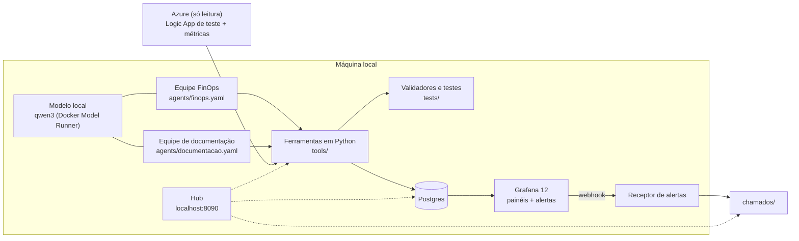
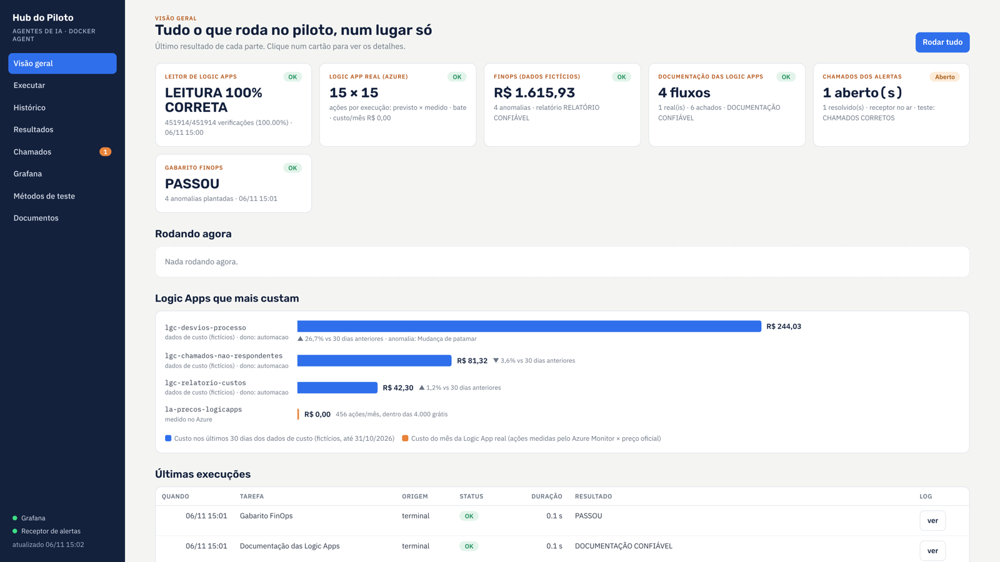
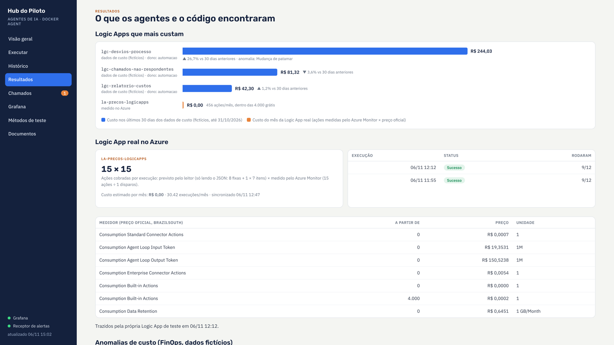
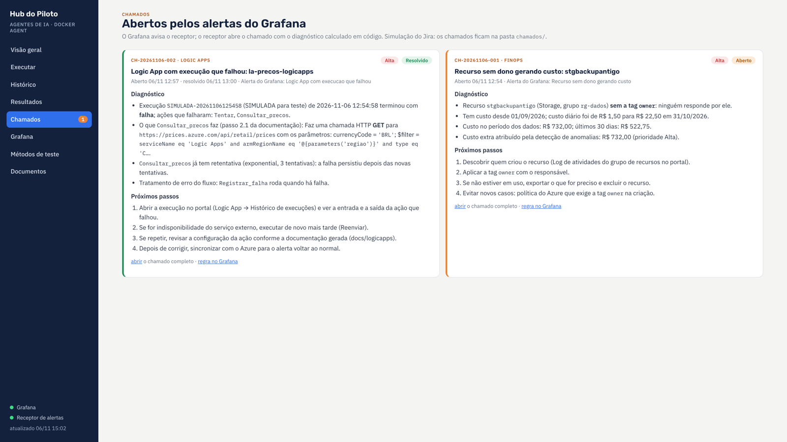

# Agentes de IA com Docker Agent

**FinOps, documentação automática de Logic Apps e um hub para acompanhar tudo, com um modelo de IA rodando localmente.**


> *English summary:* a hands-on project with [Docker Agent](https://docs.docker.com/ai/docker-agent/) teams running on a
> **local model** (qwen3 via Docker Model Runner). One team analyses Azure costs (FOCUS format) and writes a FinOps report;
> another documents Azure Logic Apps from their JSON definitions. The rule throughout: **code computes, the AI explains,
> and every output is checked against a known answer**. Everything is visible in Grafana and in a small local hub.
> All cost data is synthetic; one Logic App runs on my personal Azure for Students account.

---

## O que tem aqui

| Parte | O que faz |
|---|---|
| **Equipe FinOps** | Orquestrador → analista de custos → relator. Lê custos no formato **FOCUS 1.0** (o mesmo da exportação do Azure Cost Management), acha anomalias e escreve um relatório. |
| **Equipe de documentação** | Lê a definição JSON de Logic Apps (*Workflow Definition Language*) e gera documentação com passo a passo, diagrama Mermaid, custo estimado e achados de boas práticas. |
| **Leitor exato de Logic Apps** | Parser determinístico (sem IA): ordem real de execução pelo `runAfter`, ramos, loops, retentativas, agenda e ações cobradas por execução. |
| **Logic App real no Azure** | Uma Logic App de teste na minha conta de estudante, ligada ao projeto **só para leitura**. O custo previsto pelo leitor é conferido com o medido pelo Azure Monitor. |
| **Grafana** | Painéis de custo e de operação, e 3 alertas que viram **chamados com diagnóstico** (simulando um Jira). |
| **Hub** | Página local que junta tudo: executar tarefas com log ao vivo, histórico, resultados, chamados, Grafana e documentos. |

## Por que assim: código calcula, IA explica

Nos primeiros testes com o modelo local, o agente relator **inventou recursos e valores** (um total de R$ 50 mil que não existia)
e depois **disse que tinha salvo o arquivo sem ter salvo**. As evidências estão em
[`relatorios/relatorio-finops-tentativa1-alucinado.md`](relatorios/relatorio-finops-tentativa1-alucinado.md).

Daí vieram as regras do projeto:

1. **Números, arquivos e documentação saem de Python.** O modelo coordena, consulta as ferramentas e explica.
2. **Tudo tem gabarito.** Os dados de custo têm 4 anomalias plantadas e as Logic Apps de exemplo têm 6 problemas plantados.
3. **Validadores reprovam** relatório ou documentação com item inventado, faltando ou com valor errado.
4. **Hooks `stop` do Docker Agent** geram e validam o resultado sempre que o agente termina, mesmo se o modelo esquecer.

## Resultados

| O que | Resultado |
|---|---|
| Bateria do leitor de Logic Apps | **451.914 / 451.914** verificações: agendas, 28 expressões, gatilhos, fluxos com gabarito escrito à mão, exemplos JSON da documentação oficial, 2.000 fluxos aleatórios e mutações |
| Sabotagem dos testes | O leitor foi estragado de propósito de vários jeitos e a bateria reprovou em todos |
| Previsto × medido (Azure real) | **15 ações cobradas por execução previstas** só lendo o JSON e **15 medidas** pelo Azure Monitor |
| Receptor de alertas | **30 / 30** verificações com alertas reais capturados do Grafana 12 |
| Relatório FinOps | Acha as 4 anomalias do gabarito, com valores conferidos pelo validador |

## Arquitetura



## Telas

| Visão geral | Executar com log ao vivo |
|---|---|
|  |  |
| **Resultados** | **Chamados abertos pelos alertas** |
|  |  |


## Como rodar

**Pré-requisitos:** Docker Desktop 4.63+ (já traz o Docker Agent), Docker Model Runner ativado e Python 3 no PATH.

```bash
# 1. Conferir os dados e o leitor (não precisa de Docker)
python tests/validar_gabarito.py            # RESULTADO: PASSOU
python tests/testar_leitor_logicapps.py     # RESULTADO: LEITURA 100% CORRETA

# 2. Subir Postgres + Grafana + receptor de alertas
docker compose up -d                        # Grafana em http://localhost:3000 (admin / admin)
python tools/carregar_grafana.py

# 3. Abrir o hub
python tools/hub.py                         # http://localhost:8090

# 4. Rodar os agentes com o modelo local
docker model pull ai/qwen3
docker agent run agents/finops.yaml         # "Analise os custos e gere o relatório"
docker agent run agents/documentacao.yaml   # "Documente as Logic Apps"
```

Também dá para rodar tudo pelo terminal: `python tools/rodar.py tudo`.

### Logic App real (opcional)

Para ligar uma Logic App sua, siga [`azure/LEIA-ME.md`](azure/LEIA-ME.md) e depois rode:

```bash
python tools/azure_logicapp.py sincronizar
```

O que a Logic App de teste faz: consulta 1 vez por dia a API pública de preços do Azure, usando só ações nativas, e fica dentro das
4.000 execuções grátis por mês. O acesso é só leitura, via Azure CLI (`az login`). A configuração com o ID da assinatura fica em
`config/azure.json`, que está fora do Git.

### Testar o alerta de falha

```bash
python tools/carregar_grafana.py --simular-falha     # em ~1 min o Grafana dispara e o receptor abre um chamado
python tools/carregar_grafana.py --limpar-simulacao  # o alerta volta ao normal e o chamado é marcado como resolvido
```

## Estrutura

```text
agents/        equipes do Docker Agent (FinOps e documentação)
tools/         ferramentas em Python, receptor de alertas e hub
tests/         validadores e baterias de teste, com casos e gabaritos
data/          gerador de custos no formato FOCUS + gabarito das anomalias
logicapps/     Logic Apps de exemplo (fictícias) e a Logic App real de teste
azure/         definição e modelo ARM da Logic App de teste + passo a passo
grafana/       provisionamento: datasource, painéis e alertas
docs/          documentação gerada das Logic Apps e imagens deste README
relatorios/    relatórios gerados (inclui as tentativas que falharam)
```

Guia detalhado de cada parte (todos os comandos, arquivos e o gabarito das anomalias): [`docs/guia-completo.md`](docs/guia-completo.md).

## Limites conhecidos

- O modelo local é pequeno: por isso a redação dos números fica em código. Com um modelo maior, dá para devolver a redação ao agente mantendo os validadores.
- O que um trecho de JavaScript (ação *Execute JavaScript Code*) lê de outras ações não é analisado; a documentação avisa quando isso acontece.
- Os chamados são arquivos locais. Ligar no Jira de verdade é o próximo passo.

## Fontes oficiais

- [Docker Agent](https://docs.docker.com/ai/docker-agent/) · [Docker Model Runner (provider dmr)](https://docs.docker.com/ai/docker-agent/providers/dmr/) · [Ferramenta script](https://docs.docker.com/ai/docker-agent/tools/script/)
- [Workflow Definition Language](https://learn.microsoft.com/azure/logic-apps/workflow-definition-language-schema) · [Gatilhos e ações](https://learn.microsoft.com/azure/logic-apps/logic-apps-workflow-actions-triggers) · [Tratamento de erros](https://learn.microsoft.com/azure/logic-apps/error-exception-handling)
- [Cobrança das Logic Apps](https://learn.microsoft.com/azure/logic-apps/logic-apps-pricing) · [Métricas das Logic Apps](https://learn.microsoft.com/azure/logic-apps/monitor-logic-apps-reference#metrics) · [Esquema FOCUS do Azure](https://learn.microsoft.com/azure/cost-management-billing/dataset-schema/cost-usage-details-focus)
- [Alertas do Grafana por arquivo](https://grafana.com/docs/grafana/latest/alerting/set-up/provision-alerting-resources/file-provisioning/) · [Webhook do Grafana](https://grafana.com/docs/grafana/latest/alerting/configure-notifications/manage-contact-points/integrations/webhook-notifier/) · [Datasource PostgreSQL](https://grafana.com/docs/grafana/v12.4/datasources/postgres/configure/)

## Licença

[MIT](LICENSE). Os dados de custo e as Logic Apps de exemplo são fictícios.
