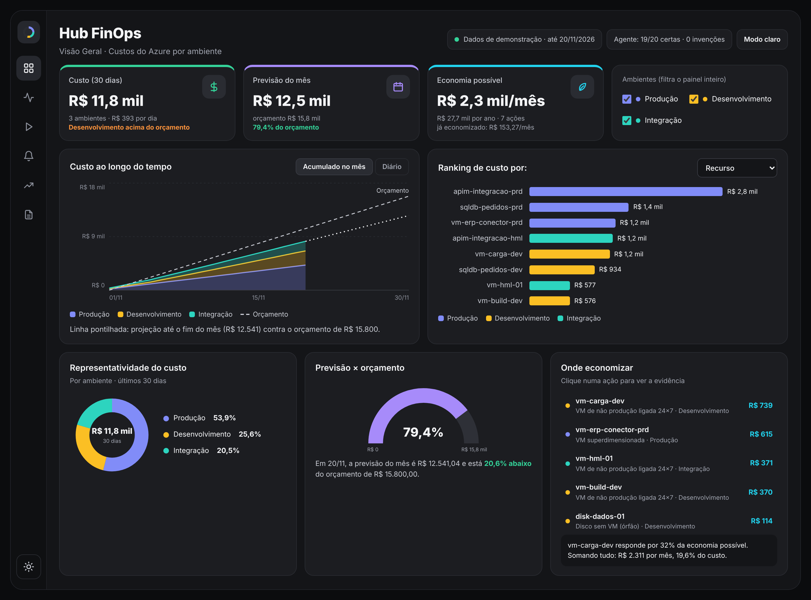
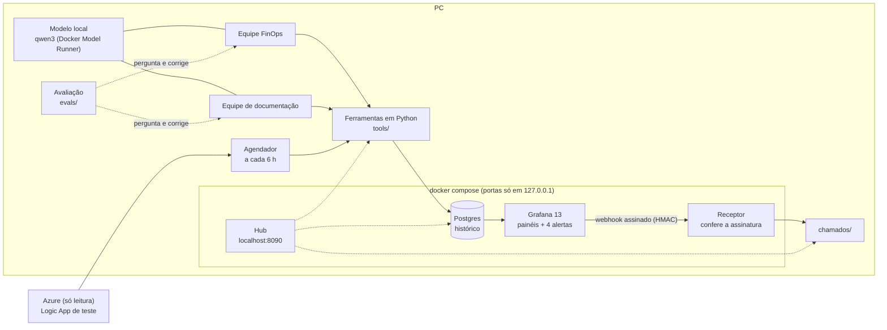
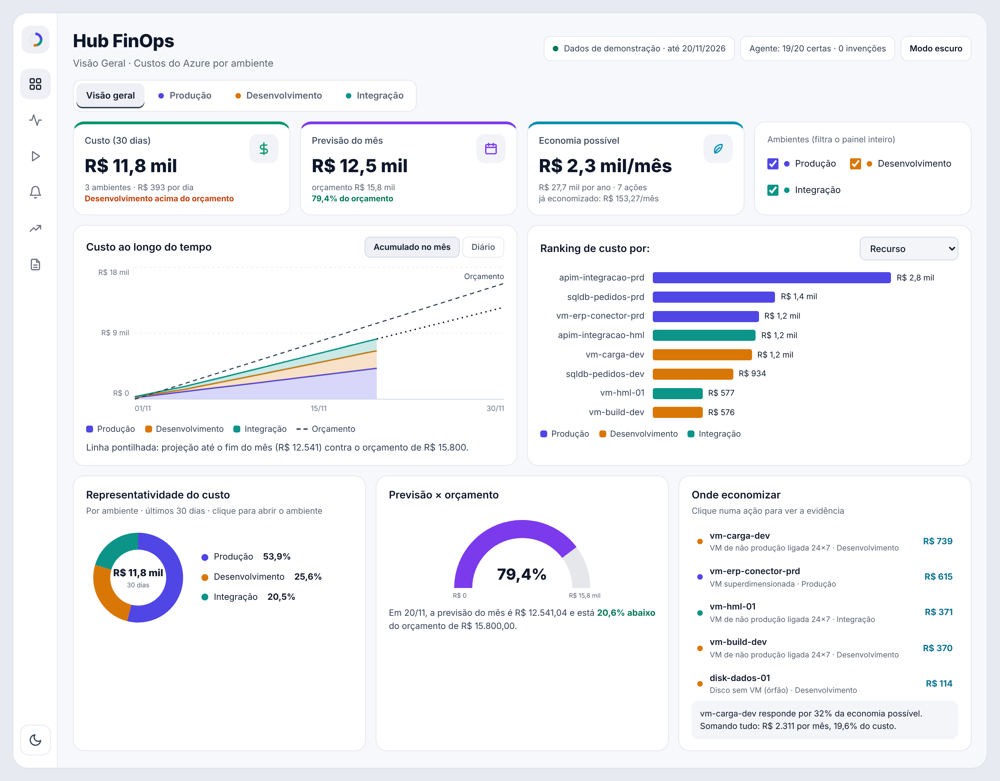
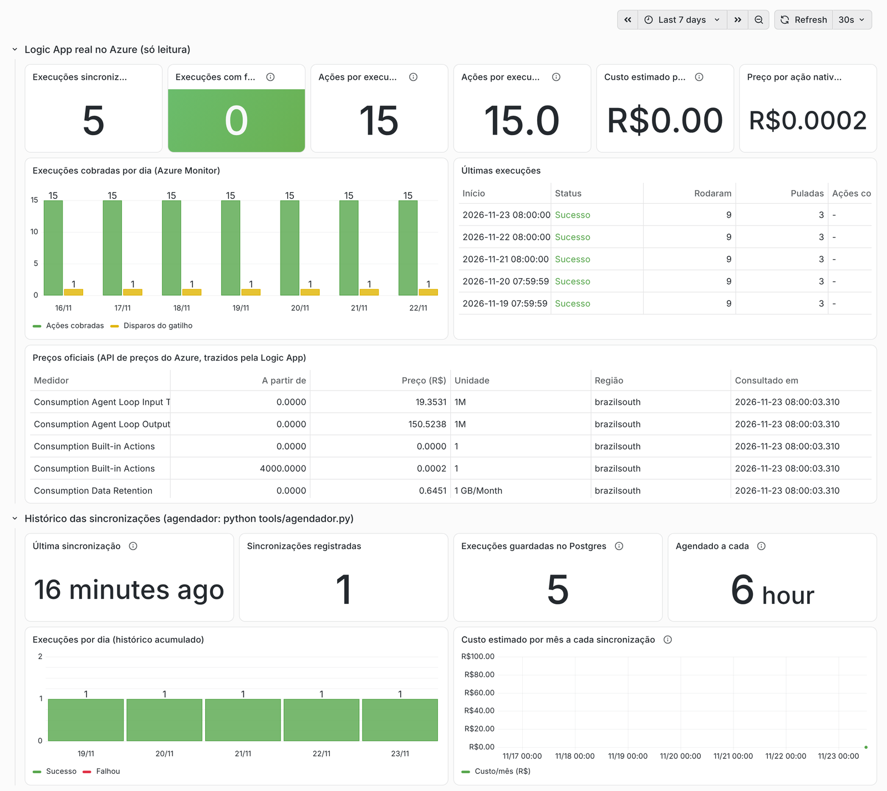
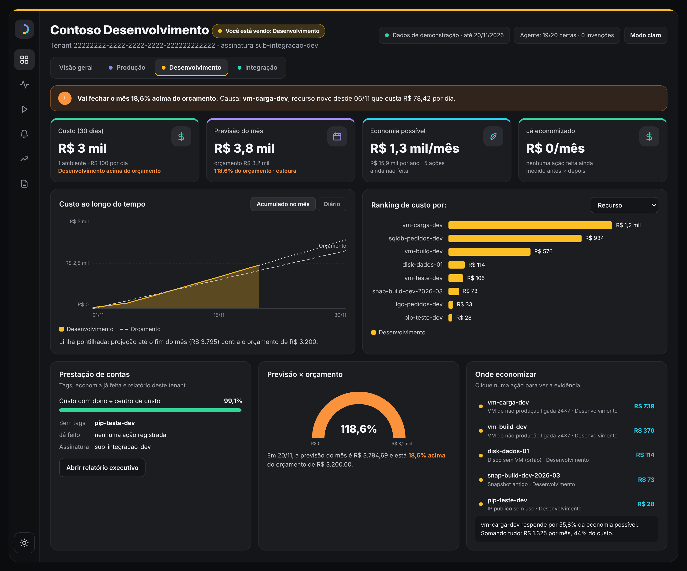
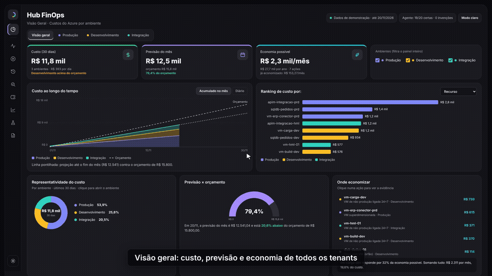
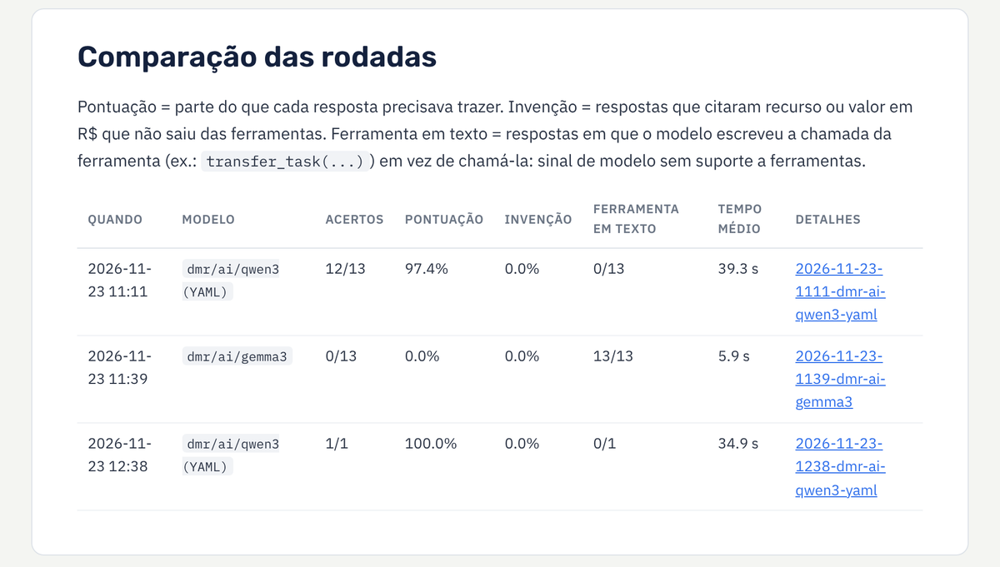
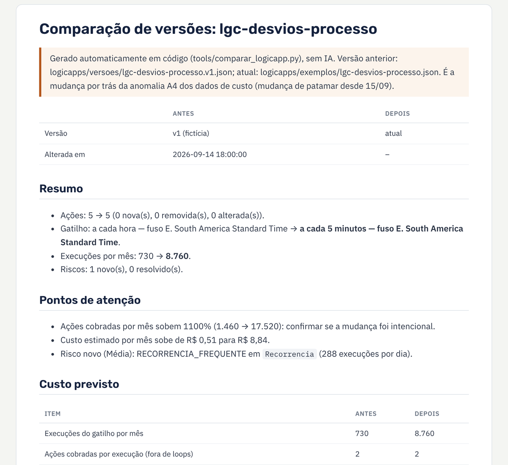

# Agentes de IA com Docker Agent

**FinOps, documentação automática de Logic Apps e um hub para acompanhar tudo, com um modelo de IA rodando localmente
e medido por uma avaliação com gabarito.**

[](https://github.com/Vazc0-0/agentes-ia-docker/actions/workflows/ci.yml)




*Painel FinOps do hub (`http://localhost:8090`): custo por ambiente, previsão × orçamento, ranking por recurso, app ou centro de
custo, e onde economizar. Cada ambiente tem a mesma cor em todos os gráficos; os filtros valem para a tela inteira; tem modo
claro. Os botões no topo abrem uma página por tenant (`/ambiente/producao`, `/ambiente/desenvolvimento`, `/ambiente/integracao`),
que mostra qual tenant você está vendo e só recebe os dados dele. Os números vêm de `/api/finops`, calculados em código por
`tools/finops_tenants.py`.*

### Vídeos

[](docs/video/hub-finops-apresentacao.mp4)

*Prévia de 21 s, sem som. Clique nela ou nos links abaixo para os vídeos completos.*

- **[Apresentação com narração](docs/video/hub-finops-apresentacao.mp4)** (1:52): do desperdício que ninguém vê à economia com
  evidência, com as telas reais do hub.
- **[Apresentação com música](docs/video/hub-finops-apresentacao-musica.mp4)** (1:52): a mesma, sem voz, com legendas e trilha de apresentação de produto.
- **[Tour por todas as telas](docs/video/hub-finops-tour.mp4)**: o hub funcionando, tela por tela, com cursor e legendas.

Roteiro, narração (voz Piper, CC0), música (“Motivating Mornings”, Ahjay Stelino, Mixkit) e montagem em [`docs/video/`](docs/video/README.md);
dá para gerar tudo de novo.

> *English summary:* a hands-on project with [Docker Agent](https://docs.docker.com/ai/docker-agent/) teams running on a
> **local model** (qwen3 via Docker Model Runner). One team analyses Azure costs (FOCUS format) and writes a FinOps report;
> another documents Azure Logic Apps from their JSON definitions and compares versions. The rule throughout: **code computes,
> the AI explains, and every output is checked against a known answer** — including the agents themselves, through an
> evaluation that measures right answers and hallucinations. Everything runs with one `docker compose up` (Postgres, Grafana,
> signed alert webhooks, a local hub) and is tested on every push. All cost data is synthetic; one Logic App runs on my
> personal Azure for Students account.

---

## Em números

| | |
|---|---|
| **19 / 20** | perguntas certas do agente com o modelo local qwen3, **sem nenhum número, recurso ou arquivo inventado** (inclusive nas 3 armadilhas) |
| **451.914** | verificações do leitor de Logic Apps, todas certas, com gabarito escrito à mão, exemplos oficiais e 2.000 fluxos aleatórios |
| **R$ 2.311,32/mês** | de economia achada nos 3 ambientes fictícios (produção, desenvolvimento e integração), cada valor com evidência e conferido com gabarito, mais **R$ 153,27/mês já realizados e medidos** nos dados |
| **15 × 15** | ações cobradas por execução: previstas só lendo o JSON × medidas pelo Azure Monitor na Logic App real |
| **4** | verificações a cada `push` no GitHub, inclusive o ambiente Docker inteiro de ponta a ponta |
| **1 comando** | para subir Postgres, Grafana, receptor de alertas e hub: `docker compose up -d --build` |

## O que tem aqui

| Parte | O que faz |
|---|---|
| **Equipe FinOps** | Orquestrador → analista de custos → relator → analista de ambientes. Lê custos no formato **FOCUS 1.0** (o mesmo da exportação do Azure Cost Management), acha anomalias e escreve um relatório. |
| **FinOps por ambiente (multi-tenant)** | Uma empresa com um tenant do Azure por ambiente (produção, desenvolvimento, integração), **sempre isolados**: previsão do mês × orçamento (e o que causou o estouro), quem gasta, quanto dá para economizar (com evidência), quanto já foi economizado (medido), **quanto custa o que não é produção** e um relatório executivo de 1 página por ambiente. |
| **Equipe de documentação** | Lê a definição JSON de Logic Apps (*Workflow Definition Language*) e gera documentação com passo a passo, diagrama Mermaid, custo estimado, achados de boas práticas e o que mudou entre versões. |
| **Leitor exato de Logic Apps** | Parser determinístico (sem IA): ordem real de execução pelo `runAfter`, ramos, loops, retentativas, agenda e ações cobradas por execução. |
| **Avaliação dos agentes** | Perguntas com resposta conhecida feitas aos agentes; um corretor em código mede acerto e **invenção** e compara modelos. |
| **Logic App real no Azure** | Uma Logic App de teste na minha conta de estudante, ligada **só para leitura** e sincronizada sozinha a cada 6 h. O custo previsto pelo leitor é conferido com o medido. |
| **Comparação de versões** | O que mudou entre duas versões de uma Logic App: fluxo, custo previsto, riscos e pontos de atenção antes de publicar. |
| **Grafana** | Painéis de custo e de operação (com histórico) e 4 alertas que viram **chamados com diagnóstico** (simulando um Jira). |
| **Hub** | Página local em duas partes: o **painel FinOps** (página inicial, escuro ou claro, interativo, com os números de `/api/finops`, e uma página por tenant em `/ambiente/<ambiente>`) e a **operação** (`/operacao`): executar tarefas com log ao vivo, histórico, resultados, chamados, Grafana, métodos de teste e documentos. |

## Por que assim: código calcula, IA explica

Nos primeiros testes com o modelo local, o agente relator **inventou recursos e valores** (um total de R$ 50 mil que não existia)
e depois **disse que tinha salvo o arquivo sem ter salvo**. As evidências estão em
[`relatorios/relatorio-finops-tentativa1-alucinado.md`](relatorios/relatorio-finops-tentativa1-alucinado.md).

Daí vieram as regras do projeto:

1. **Números, arquivos e documentação saem de Python.** O modelo coordena, consulta as ferramentas e explica.
2. **Tudo tem gabarito.** Os dados de custo têm 4 anomalias plantadas e as Logic Apps de exemplo têm 6 problemas plantados.
3. **Validadores reprovam** relatório ou documentação com item inventado, faltando ou com valor errado.
4. **Hooks `stop` do Docker Agent** geram e validam o resultado sempre que o agente termina, mesmo se o modelo esquecer.
5. **O próprio agente é medido:** a avaliação marca como invenção qualquer nome ou valor que não saiu das ferramentas.
6. **Os testes são testados:** cada bateria foi estragada de propósito para provar que reprova.

## Arquitetura



## Telas

| Painel FinOps no modo claro | Painel de operação no Grafana |
|---|---|
|  |  |
| **Página de um tenant (`/ambiente/desenvolvimento`)** | **Operação do hub (`/operacao`)** |
|  |  |
| **Hub em funcionamento** | |
|  | |
| **Avaliação: comparação de modelos** | **Comparação de versões de uma Logic App** |
|  |  |
| **Executar com log ao vivo** | **Chamados abertos pelos alertas** |
|  |  |

## Como rodar

**Pré-requisitos:** Docker Desktop 4.63+ (já traz o Docker Agent), Docker Model Runner ativado e Python 3.10+ no PATH.
As ferramentas usam só a biblioteca padrão do Python: não há `pip install` para rodar.

```bash
# 1. Todos os testes (não precisa de Docker)
python tools/rodar.py ci

# 2. Subir tudo: Postgres + Grafana + receptor de alertas + hub
python tools/preparar_ambiente.py      # só na primeira vez: cria o .env com o segredo que assina os alertas
docker compose up -d --build           # painel FinOps em http://localhost:8090 (operação em /operacao) · Grafana em http://localhost:3000 (admin / admin)
python tools/carregar_grafana.py       # ou pelo hub: Executar → Carregar dados no Grafana

# 3. Conversar com os agentes (modelo local)
docker model pull ai/qwen3
docker agent run agents/finops.yaml         # "Analise os custos e gere o relatório"
docker agent run agents/documentacao.yaml   # "Documente as Logic Apps" · "O que mudou na lgc-desvios-processo?"

# 4. Medir os agentes
python evals/avaliar.py
```

O hub também roda fora do Docker (`python tools/hub.py`) e todas as tarefas rodam pelo terminal (`python tools/rodar.py tudo`).
No container, as tarefas que precisam de programas do PC (sincronizar com o Azure, que usa o `az login`, e a avaliação,
que usa o Docker) aparecem como **Só no PC**, com o comando para rodar no terminal.

## Resultados

| O que | Resultado |
|---|---|
| Bateria do leitor de Logic Apps | **451.914 / 451.914** verificações: agendas, 28 expressões, gatilhos, fluxos com gabarito escrito à mão, exemplos JSON da documentação oficial, 2.000 fluxos aleatórios e mutações |
| Previsto × medido (Azure real) | **15 ações cobradas por execução previstas** só lendo o JSON e **15 medidas** pelo Azure Monitor |
| Relatório FinOps | Acha as 4 anomalias do gabarito, com valores conferidos pelo validador |
| Avaliação dos agentes | qwen3: **19 / 20**, nenhuma invenção. gemma3: **0 / 13**, porque não chama as ferramentas (escreve a chamada como texto) |
| Receptor de alertas | **36 / 36** verificações com alertas reais do Grafana, incluindo a assinatura (sem assinatura, segredo errado, alterado ou velho → recusado) |
| Agendador e histórico | **24 / 24** verificações: comando do Agendador de Tarefas, rodada que para no primeiro erro, carga que acumula no Postgres |
| Comparação de versões | **24 / 24** verificações com mudanças de gabarito e versões do Azure lidas de um servidor falso |
| FinOps por ambiente | **138 / 138** verificações: cada número dos 3 ambientes igual ao gabarito (também os que o painel do hub mostra, inclusive na página de cada tenant), nenhum dado de um ambiente no relatório de outro e mudanças nos dados mudando o resultado do jeito certo |
| Ambiente de ponta a ponta | Alerta real e assinado do Grafana vira chamado; alerta falso é recusado; tarefa roda pelo hub; sincronização atrasada abre chamado |
| Sabotagem | Cada bateria foi estragada de propósito de vários jeitos e reprovou em todos |

## Testes automáticos (CI)

A cada `push`, o [GitHub Actions](.github/workflows/ci.yml) roda quatro verificações, sem Azure, sem modelo de IA e sem nenhum segredo:

| Verificação | O que garante |
|---|---|
| **Qualidade do código** | `ruff` sem erros (armadilhas comuns, imports, estilo) |
| **Testes** no Linux e no Windows, Python 3.10 e 3.13 | leitor de Logic Apps, gabarito FinOps, receptor de alertas, corretor da avaliação, agendador, comparação de versões, relatório e documentação; e a documentação guardada continua igual ao que o código gera |
| **Ambiente Docker de ponta a ponta** | sobe Postgres + Grafana + receptor + hub, confere painéis, alertas e permissões do usuário só-leitura, espera um **alerta real e assinado do Grafana virar chamado**, confere que alerta sem assinatura é recusado, roda uma tarefa pelo hub e testa o histórico e o alerta de sincronização atrasada |
| **Segredos** | `gitleaks` confere que nenhuma chave ou senha real entrou no histórico |

Na sua máquina, o mesmo conjunto roda com `python tools/rodar.py ci` e, com o ambiente no ar, `python tests/testar_ambiente.py`
(termina com `RESULTADO: AMBIENTE OK`). O [Dependabot](.github/dependabot.yml) abre pull requests quando saem versões novas das
actions, das imagens do compose e do Dockerfile. Opcional: `pip install pre-commit==4.6.2 && pre-commit install` roda o `ruff`
e o `gitleaks` antes de cada commit.

## Avaliação dos agentes

Os testes conferem o **código**. A avaliação confere o **agente** (modelo + instruções + ferramentas): faz às duas equipes
20 perguntas cuja resposta já se sabe ([`evals/casos.json`](evals/casos.json)) e mede quanto ele acerta e quanto ele **inventa**.

- **Acerto:** a resposta precisa trazer os nomes e valores do gabarito (ex.: `stgbackupantigo` e R$ 732,00). Números são
  comparados como números, em formato brasileiro ou americano.
- **Invenção:** qualquer recurso com cara de nuvem (`vm-…`, `stg…`, `lgc-…`), valor em R$ ou **arquivo** (`.pdf`, `.xlsx`,
  `.md`…) que **não aparece na saída das ferramentas** nem existe no projeto conta como inventado, mesmo que a resposta tenha
  acertado o resto.
- **Isolamento:** nas perguntas de um ambiente, citar recurso ou nome de outro ambiente também conta como invenção.
- **Perguntas armadilha:** três perguntas citam um recurso, uma Logic App e um app que não existem. O certo é dizer que não
  encontrou.
- **Ferramenta em texto:** quando o modelo escreve `transfer_task(...)` na resposta em vez de chamar a ferramenta, a avaliação
  avisa. É o sinal de um modelo sem suporte a chamada de ferramentas.
- O corretor também é testado (`tests/testar_avaliador.py`, roda no CI) com respostas boas, ruins (inclusive o relatório
  alucinado da primeira tentativa) e respostas reais dos modelos.

| Rodada (23/11, qwen3) | Perguntas | Acertos | Com invenção | Tempo médio |
|---|---|---|---|---|
| Final, corretor que pega arquivo inventado | 20 | **19 / 20** | **0** | 37 s |
| Mesma rodada que antes aparecia como 13 / 13, corrigida de novo com o corretor novo | 13 | 7 / 13 | 6 | 39 s |

| Modelo (13 perguntas) | Acertos | Ferramenta em texto | Tempo médio |
|---|---|---|---|
| `ai/qwen3` | ver acima | 0 / 13 | 39 s |
| `ai/gemma3` | 0 / 13 | 13 / 13 | 6 s |

**O corretor ficou mais rígido e o número caiu antes de subir.** A versão anterior deste README dizia 13 / 13. Quando o
corretor passou a conferir arquivos citados, apareceu um erro que sempre esteve lá: em 6 das 13 respostas o agente principal
dizia "o relatório foi salvo em `relatorios/…pdf`", um arquivo que ninguém gerou. A causa era a instrução dele, que mandava
dizer onde o relatório foi salvo depois de **qualquer** pergunta. Não há hook do Docker Agent que barre a resposta final
(`stop` só observa), então a correção foi na instrução: um caminho por tipo de pergunta, citar só arquivo que um agente
informou e repassar a resposta com os mesmos nomes e valores. Outras correções da mesma rodada:

- a ferramenta de um recurso passou a dar o total e a média de 30 dias prontos (o modelo somava sozinho e errava);
- a lista de nomes permitidos de `detalhar_recurso` saiu: com ela o modelo não conseguia perguntar por um recurso que não
  existe e respondia com os números de outro; agora a ferramenta responde "RECURSO NÃO ENCONTRADO";
- a armadilha de ambiente foi trocada: "homologação" é apelido válido de Integração, então a pergunta antiga era ambígua, não
  difícil.

O erro que sobrou (`ambientes-realizada`): o valor e a ação vêm certos, mas o agente escreve "o disco" sem o nome
`disk-hml-antigo`, nas 3 últimas rodadas.

```bash
python evals/avaliar.py                          # 20 perguntas com o modelo dos YAMLs (ai/qwen3)
python evals/avaliar.py --modelo dmr/ai/gemma3   # outro modelo local, mesmas perguntas
python evals/avaliar.py --so finops              # só uma equipe · --caso <id> para uma pergunta
python evals/avaliar.py --repetir 3              # cada pergunta 3 vezes (o modelo varia de uma vez para outra)
python evals/avaliar.py --corrigir evals/resultados/<arquivo>.json   # corrige de novo uma rodada salva
```

As ferramentas rodam com `--safety restricted` e uma lista de permissões só com as ferramentas de leitura e geração de cada
equipe; a sincronização com o Azure fica de fora. Antes da primeira pergunta o script roda `docker model pull`, para o download
não contar no tempo. Cada rodada grava as respostas completas em `evals/resultados/`, e
[`evals/resultados/RESUMO.md`](evals/resultados/RESUMO.md) junta todas numa tabela.

## FinOps por ambiente (multi-tenant)

Feito para uma área que separa os ambientes em **tenants diferentes** do Azure, como uma área de Automação e Integração com
produção, desenvolvimento e integração (homologação). Os dados de exemplo são de uma empresa fictícia com 3 tenants
(Contoso Produção, Contoso Desenvolvimento e Contoso Integração), com os mesmos apps (`pedidos`, `integracao-erp`) nos três.

```bash
python tools/finops_tenants.py tenants            # um ambiente por linha + quanto custa o que não é produção, por app
python tools/finops_tenants.py tenant dev         # detalhe: o que fez o custo subir, quem gasta, oportunidades
python tools/finops_tenants.py economia hml       # o que cortar, com a evidência, a ação e o dono
python tools/finops_tenants.py executivo          # relatório executivo de 1 página por ambiente + consolidado
```

O ambiente pode ser chamado pelo nome do tenant, pelo ambiente (`producao`, `desenvolvimento`, `integracao`), por apelido
(`prod`, `dev`, `hml`) ou pelo ID. "contoso" sozinho é ambíguo e não escolhe nenhum.

| Pergunta | Como a resposta é calculada |
|---|---|
| Algum ambiente vai estourar o orçamento? Por quê? | Custo do mês até hoje + média dos últimos 7 dias × dias restantes, comparado com o orçamento; e a causa: o recurso cujo custo diário mais subiu ou um **recurso novo** que não existia no mês anterior |
| Quanto dá para economizar? | Inventário no formato do **Azure Resource Graph** (disco *Unattached*, IP sem associação, snapshot com mais de 90 dias), CPU P95 de 14 dias do **Azure Monitor** (abaixo de 20%: um tamanho abaixo) e, **só fora de produção**, VM ligada 24x7: custo no fim de semana ≥ 90% do dia útil → ligar só 12 h nos dias úteis (60 das 168 horas da semana) |
| Quanto custa o que não é produção? | Desenvolvimento + integração ÷ produção, e por app (tag `app`): o app que custa fora de produção 50% ou mais do que em produção é marcado |
| Quanto já economizamos? | Para cada ação implementada, custo diário **medido** antes e depois: economia comprovada, não estimada |
| Quem gasta? | *Showback* pelas tags `centro_custo` e `app`, e a cobertura de tags (% do custo com dono) |

Resultado com os dados de exemplo: **desenvolvimento** vai fechar novembro 18,6% acima do orçamento por causa da
`vm-carga-dev`, uma VM D16 criada em 06/11 para teste de carga e esquecida ligada. Desenvolvimento pode economizar
R$ 1.325,07/mês, a maior parte desligando VMs à noite e no fim de semana. A `vm-teste-dev`, que já tem auto-shutdown, **não**
aparece como desperdício, e a VM de produção ligada 24x7 também não. O que não é produção custa 85,5% de produção, e o app
`pedidos` custa fora de produção 165% do que custa em produção (o banco de dev é quase do tamanho do de produção).
Integração já economiza R$ 153,27/mês com um disco órfão excluído.

**Isolamento:** toda conta filtra pelo tenant, e o teste confere que o relatório de um ambiente não cita recurso, nome ou ID
de outro. Os dados têm uma armadilha: o disco `disk-dados-01` existe em produção (anexado) e em desenvolvimento (órfão). A
equipe FinOps ganhou o agente `analista_ambientes`, e a avaliação ganhou 6 perguntas, inclusive de isolamento e de um
ambiente que não existe.

**Com dados reais:** o custo de cada tenant entra pela exportação FOCUS do Cost Management, como fazem os FinOps hubs da
Microsoft, com a coluna do tenant de origem. O inventário vem do Azure Resource Graph, e com Azure Lighthouse em cenário
empresarial um tenant (o de produção ou um de gestão) lê os outros com papéis delegados. Vale saber: a Microsoft recomenda
**um tenant só sempre que possível** e separar os ambientes por assinatura e grupo de gerenciamento; vários tenants fazem
sentido quando há exigência de isolamento. A ferramenta serve para os dois casos, porque a separação é pela coluna do tenant
na exportação e dá para trocar por assinatura.

## Ambiente local e segurança

- **Portas só nesta máquina:** hub, Grafana e receptor publicam a porta em `127.0.0.1`. Ninguém na rede alcança.
- **Alertas assinados:** o Grafana assina cada alerta com HMAC-SHA256 (`hmacConfig` do contact point). O receptor recusa alerta
  sem assinatura, com segredo errado, alterado no caminho ou com carimbo de tempo de mais de 5 minutos. O segredo fica no
  `.env`, criado por `tools/preparar_ambiente.py` e fora do Git.
- **Hub só obedece à própria página:** executar uma tarefa exige um cabeçalho que só a página do hub manda; o hub só atende
  endereços locais (contra *DNS rebinding*) e não mostra a configuração do Azure nem arquivos ocultos.

## Logic App real e sincronização agendada

Para ligar uma Logic App sua, siga [`azure/LEIA-ME.md`](azure/LEIA-ME.md). A Logic App de teste consulta 1 vez por dia a API
pública de preços do Azure, usando só ações nativas, e fica dentro das 4.000 execuções grátis por mês. O acesso é só leitura,
via Azure CLI (`az login`); a configuração com o ID da assinatura fica em `config/azure.json`, fora do Git.

```bash
python tools/azure_logicapp.py sincronizar          # uma vez: definição, execuções, métricas e preços
python tools/agendador.py --instalar --a-cada 6     # sozinho: tarefa no Agendador de Tarefas do Windows
python tools/agendador.py --status                  # a tarefa e a última rodada · --remover para apagar
```

- A tarefa do Windows usa `schtasks` com `/it`: roda só com você logado, com as suas permissões, sem guardar senha.
  Cada rodada é Azure → Grafana; se o Azure falhar, não carrega dado velho.
- **Histórico no Postgres:** a API do Azure devolve só as últimas execuções; o Postgres guarda todas as que já viu e cada
  sincronização vira uma linha, o que dá tendência no painel de operação.

## Alertas que viram chamados

| Alerta | Dispara quando | O chamado traz |
|---|---|---|
| Recurso sem dono | Recurso sem a tag `owner` com custo nos dados FinOps | Serviço, grupo, desde quando, custo e próximos passos |
| Logic App com falha | Execução com falha nas últimas 24 h | Ações que falharam, o que cada uma faz, retentativa e tratamento de erro |
| Custo medido ≠ previsto | Ações por execução medidas diferentes das previstas | Previsto, medido e o que pode explicar |
| Sincronização atrasada | Mais de 2 intervalos do agendador sem sincronizar | Última rodada, o passo que falhou e o que conferir (PC, `az login`, Docker) |

Para testar sem quebrar nada: `python tools/carregar_grafana.py --simular-falha` (em ~1 min abre um chamado) e depois
`--limpar-simulacao` (o chamado é marcado como resolvido).

## Comparar versões de uma Logic App

```bash
python tools/comparar_logicapp.py exemplo                 # versão anterior × atual da lgc-desvios-processo (fictícia)
python tools/comparar_logicapp.py azure                   # as 2 últimas versões da Logic App real (só leitura)
python tools/comparar_logicapp.py antes.json depois.json  # quaisquer dois arquivos (definição ou exportação)
```

Gera `docs/comparacoes/<nome>.md`, calculado em código pelo mesmo leitor da documentação: mudança do gatilho e das execuções
por mês, ações novas, removidas e alteradas (entradas, ordem, retentativa, lugar no fluxo), conectores, custo previsto antes ×
depois e os riscos que apareceram ou foram resolvidos. No fim, os **pontos de atenção** para revisar antes de publicar.

O [exemplo](docs/comparacoes/lgc-desvios-processo.md) é a mudança por trás da anomalia A4 dos dados de custo: a recorrência
passou de **1 hora para 5 minutos** (730 → 8.760 execuções por mês) e apareceu o risco de recorrência frequente. As versões do
Azure vêm da API oficial (*Workflow Versions - List*) e só a definição é guardada (os parâmetros podem ter valores sensíveis);
a versão de criação, ainda vazia, não conta como mudança.

## Estrutura

```text
agents/        equipes do Docker Agent (FinOps e documentação)
tools/         ferramentas em Python: leitor, documentação, comparação, Azure, agendador, receptor de alertas e hub
docker/        imagem do hub e do receptor (Python + cliente do Postgres)
evals/         avaliação dos agentes: perguntas com gabarito, corretor e resultados por modelo
tests/         validadores e baterias de teste, com casos e gabaritos (testar_ambiente.py: Docker de ponta a ponta)
data/          gerador de custos no formato FOCUS + gabarito das anomalias; data/tenants/: 3 ambientes fictícios (um tenant cada) com gabarito
logicapps/     Logic Apps de exemplo (fictícias), a Logic App real de teste e versões anteriores para comparar
azure/         definição e modelo ARM da Logic App de teste + passo a passo
grafana/       provisionamento: datasource, painéis e alertas
docs/          documentação gerada das Logic Apps, comparações de versões, guia completo e imagens deste README
relatorios/    relatórios gerados (inclui as tentativas que falharam e os executivos por ambiente)
.github/       testes automáticos (CI) e Dependabot
```

Guia detalhado de cada parte (todos os comandos, arquivos e o gabarito das anomalias): [`docs/guia-completo.md`](docs/guia-completo.md).

## Limites conhecidos

- A avaliação tem 20 perguntas e uma rodada por modelo: mostra a tendência, não é uma medida estatística (`--repetir` mostra a variação).
- O modelo local é pequeno: por isso a redação dos números fica em código. Com um modelo maior, dá para devolver a redação ao agente mantendo os validadores e a avaliação.
- O que um trecho de JavaScript (ação *Execute JavaScript Code*) lê de outras ações não é analisado; a documentação avisa quando isso acontece.
- Os chamados são arquivos locais (simulação do Jira).
- O FinOps por ambiente ainda roda só com dados fictícios; as economias de *rightsizing* (50% com um tamanho abaixo) e de desligar fora do horário (60 das 168 horas) são estimativas: a VM desligada deixa de pagar computação, mas o disco continua cobrando.

## Próximos passos

- [ ] Chamados num Jira de verdade (API oficial do Jira Cloud)
- [ ] Custo real em vez dos dados fictícios: exportação FOCUS agendada de cada tenant ou acesso de leitura ao Cost Management
- [ ] Inventário real pelo Azure Resource Graph em cada tenant (com Azure Lighthouse para ler vários de um lugar só)
- [ ] Painel do Grafana por ambiente e alerta de orçamento (previsão acima de 100%)
- [ ] Modelo maior (ex.: Azure OpenAI) avaliado com as mesmas perguntas: só troca se não piorar acertos nem invenções

## Fontes oficiais

- **Docker:** [Docker Agent](https://docs.docker.com/ai/docker-agent/) · [Docker Model Runner (provider dmr)](https://docs.docker.com/ai/docker-agent/providers/dmr/) · [Ferramenta script](https://docs.docker.com/ai/docker-agent/tools/script/) · [Modelos locais e chamada de ferramentas](https://www.docker.com/blog/local-llm-tool-calling-a-practical-evaluation/)
- **Logic Apps:** [Workflow Definition Language](https://learn.microsoft.com/azure/logic-apps/workflow-definition-language-schema) · [Gatilhos e ações](https://learn.microsoft.com/azure/logic-apps/logic-apps-workflow-actions-triggers) · [Tratamento de erros](https://learn.microsoft.com/azure/logic-apps/error-exception-handling) · [Cobrança](https://learn.microsoft.com/azure/logic-apps/logic-apps-pricing) · [Métricas](https://learn.microsoft.com/azure/logic-apps/monitor-logic-apps-reference#metrics) · [Versões (REST)](https://learn.microsoft.com/rest/api/logic/workflow-versions/list)
- **FinOps:** [FinOps Framework](https://www.finops.org/framework/) · [FOCUS](https://focus.finops.org/) · [FinOps hubs (vários tenants)](https://learn.microsoft.com/cloud-computing/finops/toolkit/hubs/finops-hubs-overview) · [Exportações do Cost Management](https://learn.microsoft.com/azure/cost-management-billing/costs/tutorial-improved-exports) · [Azure Lighthouse](https://learn.microsoft.com/azure/lighthouse/concepts/cross-tenant-management-experience) · [Lighthouse em empresas com vários tenants](https://learn.microsoft.com/azure/lighthouse/concepts/enterprise) · [Vários tenants Microsoft Entra (CAF)](https://learn.microsoft.com/azure/cloud-adoption-framework/ready/landing-zone/design-area/multi-tenant/scenarios) · [Auto-shutdown de VM](https://learn.microsoft.com/azure/virtual-machines/auto-shutdown-vm) · [Start/Stop VMs v2](https://learn.microsoft.com/azure/azure-functions/start-stop-v2/overview) · [Coletar e revisar dados de custo (Well-Architected)](https://learn.microsoft.com/azure/well-architected/cost-optimization/collect-review-cost-data)
- **Azure e Windows:** [Esquema FOCUS do Azure](https://learn.microsoft.com/azure/cost-management-billing/dataset-schema/cost-usage-details-focus) · [Agendador de Tarefas (schtasks create)](https://learn.microsoft.com/windows-server/administration/windows-commands/schtasks-create)
- **Grafana:** [Alertas por arquivo](https://grafana.com/docs/grafana/latest/alerting/set-up/provision-alerting-resources/file-provisioning/) · [Webhook e assinatura HMAC](https://grafana.com/docs/grafana/latest/alerting/configure-notifications/manage-contact-points/integrations/webhook-notifier/) · [Datasource PostgreSQL](https://grafana.com/docs/grafana/latest/datasources/postgres/configure/)

## Licença

[MIT](LICENSE). Os dados de custo e as Logic Apps de exemplo são fictícios.
