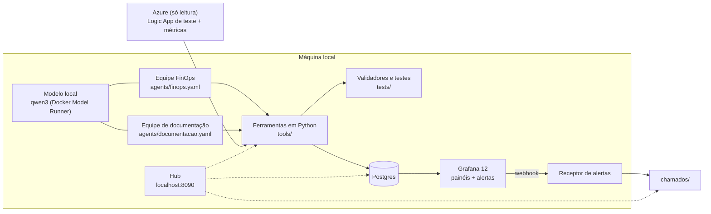
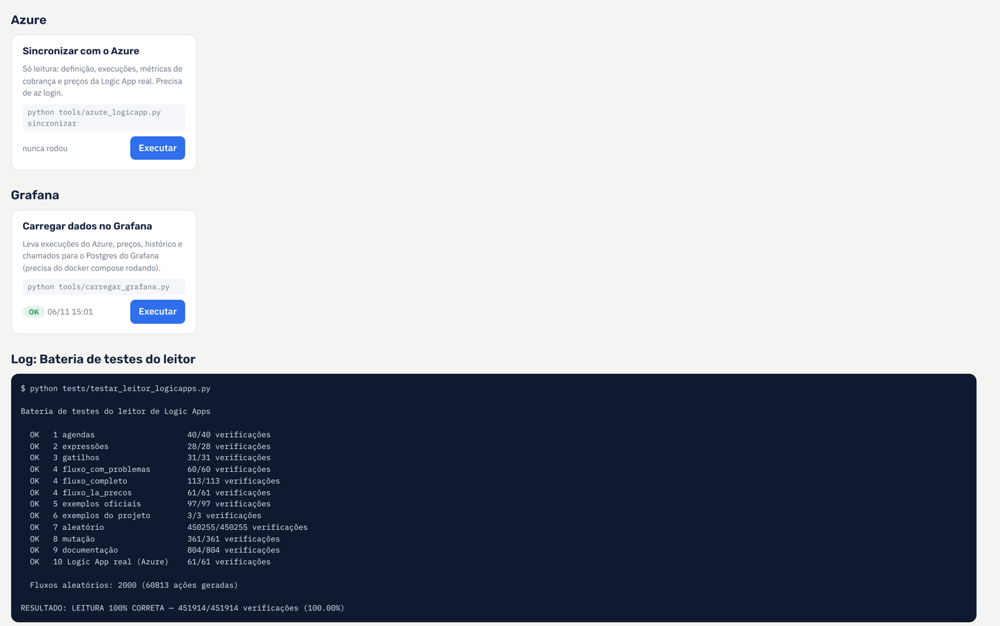

# Agentes de IA com Docker Agent

**FinOps, documentação automática de Logic Apps e um hub para acompanhar tudo, com um modelo de IA rodando localmente.**

[](https://github.com/Vazc0-0/agentes-ia-docker/actions/workflows/ci.yml)


> *English summary:* a hands-on project with [Docker Agent](https://docs.docker.com/ai/docker-agent/) teams running on a
> **local model** (qwen3 via Docker Model Runner). One team analyses Azure costs (FOCUS format) and writes a FinOps report;
> another documents Azure Logic Apps from their JSON definitions. The rule throughout: **code computes, the AI explains,
> and every output is checked against a known answer**. Everything is visible in Grafana and in a small local hub.
> All cost data is synthetic; one Logic App runs on my personal Azure for Students account.

---

## O que tem aqui

| Parte | O que faz |
|---|---|
| **Equipe FinOps** | Orquestrador → analista de custos → relator. Lê custos no formato **FOCUS 1.0** (o mesmo da exportação do Azure Cost Management), acha anomalias e escreve um relatório. |
| **Equipe de documentação** | Lê a definição JSON de Logic Apps (*Workflow Definition Language*) e gera documentação com passo a passo, diagrama Mermaid, custo estimado e achados de boas práticas. |
| **Leitor exato de Logic Apps** | Parser determinístico (sem IA): ordem real de execução pelo `runAfter`, ramos, loops, retentativas, agenda e ações cobradas por execução. |
| **Logic App real no Azure** | Uma Logic App de teste na minha conta de estudante, ligada ao projeto **só para leitura**. O custo previsto pelo leitor é conferido com o medido pelo Azure Monitor. |
| **Grafana** | Painéis de custo e de operação, e 3 alertas que viram **chamados com diagnóstico** (simulando um Jira). |
| **Hub** | Página local que junta tudo: executar tarefas com log ao vivo, histórico, resultados, chamados, Grafana e documentos. |

## Por que assim: código calcula, IA explica

Nos primeiros testes com o modelo local, o agente relator **inventou recursos e valores** (um total de R$ 50 mil que não existia)
e depois **disse que tinha salvo o arquivo sem ter salvo**. As evidências estão em
[`relatorios/relatorio-finops-tentativa1-alucinado.md`](relatorios/relatorio-finops-tentativa1-alucinado.md).

Daí vieram as regras do projeto:

1. **Números, arquivos e documentação saem de Python.** O modelo coordena, consulta as ferramentas e explica.
2. **Tudo tem gabarito.** Os dados de custo têm 4 anomalias plantadas e as Logic Apps de exemplo têm 6 problemas plantados.
3. **Validadores reprovam** relatório ou documentação com item inventado, faltando ou com valor errado.
4. **Hooks `stop` do Docker Agent** geram e validam o resultado sempre que o agente termina, mesmo se o modelo esquecer.

## Resultados

| O que | Resultado |
|---|---|
| Bateria do leitor de Logic Apps | **451.914 / 451.914** verificações: agendas, 28 expressões, gatilhos, fluxos com gabarito escrito à mão, exemplos JSON da documentação oficial, 2.000 fluxos aleatórios e mutações |
| Sabotagem dos testes | O leitor foi estragado de propósito de vários jeitos e a bateria reprovou em todos |
| Previsto × medido (Azure real) | **15 ações cobradas por execução previstas** só lendo o JSON e **15 medidas** pelo Azure Monitor |
| Receptor de alertas | **36 / 36** verificações com alertas reais capturados do Grafana, incluindo assinatura: sem assinatura, segredo errado, alerta alterado e reenvio velho são recusados |
| Relatório FinOps | Acha as 4 anomalias do gabarito, com valores conferidos pelo validador |
| Avaliação dos agentes (qwen3 local) | **13 / 13** perguntas certas, **nenhuma invenção**, inclusive nas 2 perguntas armadilha ([resultados](evals/resultados/RESUMO.md)) |
| Comparação com gemma3 | **0 / 13**: o modelo não chama as ferramentas, escreve a chamada como texto. A avaliação detecta e mostra isso |

## Testes automáticos (CI)

A cada `push`, o [GitHub Actions](.github/workflows/ci.yml) roda quatro verificações, sem Azure, sem modelo de IA e sem nenhum segredo:

| Verificação | O que garante |
|---|---|
| **Qualidade do código** | `ruff` sem erros (armadilhas comuns, imports, estilo) |
| **Testes** no Linux e no Windows, Python 3.10 e 3.13 | bateria do leitor de Logic Apps, gabarito FinOps, receptor de alertas, relatório e documentação validados; e a documentação versionada continua igual ao que o código gera |
| **Ambiente Docker de ponta a ponta** | sobe Postgres + Grafana + receptor + hub, confere painéis, alertas e permissões do usuário só-leitura, espera um **alerta real e assinado do Grafana virar chamado** com o diagnóstico certo, confere que alerta sem assinatura é recusado e roda uma tarefa pelo hub |
| **Segredos** | `gitleaks` confere que nenhuma chave ou senha real entrou no histórico |

Na sua máquina, o mesmo conjunto roda com:

```bash
python tools/rodar.py ci              # testes (não precisa de Docker)
python tools/preparar_ambiente.py     # uma vez: cria o .env com o segredo dos alertas
docker compose up -d --build --wait   # e, com o ambiente no ar:
python tests/testar_ambiente.py       # RESULTADO: AMBIENTE OK
```

O [Dependabot](.github/dependabot.yml) abre pull requests quando saem versões novas das actions e das imagens Docker.
Opcional: `pip install pre-commit==4.6.2 && pre-commit install` roda o `ruff` e o `gitleaks` antes de cada commit.

## Avaliação dos agentes

Os testes acima conferem o **código**. A avaliação confere o **agente**: faz às duas equipes 13 perguntas cuja resposta
já se sabe ([`evals/casos.json`](evals/casos.json)) e mede quanto ele acerta e quanto ele **inventa**.

- **Acerto:** a resposta precisa trazer os nomes e valores do gabarito (ex.: `stgbackupantigo` e R$ 732,00).
  Números são comparados como números, em formato brasileiro ou americano.
- **Invenção:** qualquer recurso com cara de nuvem (`vm-…`, `stg…`, `lgc-…`) ou valor em R$ que **não aparece na saída
  das ferramentas** conta como inventado, mesmo que a resposta tenha acertado o resto.
- **Perguntas armadilha:** duas perguntas citam um recurso e uma Logic App que não existem. O certo é dizer que não
  encontrou; responder com números é invenção.
- **Ferramenta em texto:** quando o modelo escreve `transfer_task(...)` na resposta em vez de chamar a ferramenta, a
  avaliação avisa. É o sinal de um modelo sem suporte a chamada de ferramentas.
- O corretor é testado com respostas boas e ruins conhecidas (`tests/testar_avaliador.py`, roda no CI), incluindo o
  relatório alucinado da primeira tentativa e respostas reais dos modelos.

| Modelo | Acertos | Invenção | Ferramenta em texto | Tempo médio |
|---|---|---|---|---|
| `ai/qwen3` | 13 / 13 | 0 | 0 / 13 | 39 s |
| `ai/gemma3` | 0 / 13 | 0 | 13 / 13 | 6 s |

A rodada do qwen3 foi gravada como 12 / 13: a resposta sobre riscos estava certa, mas escrevia `SEM_TRATAMENTO_DE_ERRO`
e o corretor ainda não aceitava o sublinhado. Corrigida com `--corrigir`, dá 13 / 13, e a resposta virou caso de teste.

```bash
python evals/avaliar.py                          # 13 perguntas com o modelo dos YAMLs (ai/qwen3)
python evals/avaliar.py --so finops              # só uma equipe
python evals/avaliar.py --caso finops-sem-dono   # uma pergunta
python evals/avaliar.py --modelo dmr/ai/gemma3   # outro modelo local, mesmas perguntas, para comparar
python evals/avaliar.py --repetir 3              # cada pergunta 3 vezes (o modelo varia de uma vez para outra)
python evals/avaliar.py --corrigir evals/resultados/<arquivo>.json   # corrige de novo uma rodada salva, sem rodar o modelo
```

Precisa do Docker Desktop com o Docker Model Runner ativado. Antes da primeira pergunta o script roda `docker model pull` (com o progresso na tela), para o download de um modelo novo não contar no tempo das respostas. As ferramentas rodam com
`--safety restricted` e uma lista de permissões só com as ferramentas de leitura e geração de cada equipe; a
sincronização com o Azure fica de fora. Cada rodada grava `evals/resultados/<data>-<modelo>.md` com as respostas
completas, e [`evals/resultados/RESUMO.md`](evals/resultados/RESUMO.md) junta todas as rodadas numa tabela para
comparar modelos.

## Arquitetura



## Telas

| Visão geral | Executar com log ao vivo |
|---|---|
|  |  |
| **Resultados** | **Chamados abertos pelos alertas** |
|  |  |


## Como rodar

**Pré-requisitos:** Docker Desktop 4.63+ (já traz o Docker Agent), Docker Model Runner ativado e Python 3 no PATH.

```bash
# 1. Rodar todos os testes (não precisa de Docker)
python tools/rodar.py ci                    # leitor, gabarito, receptor, relatório e documentação

# 2. Subir tudo: Postgres + Grafana + receptor de alertas + hub
python tools/preparar_ambiente.py           # só na primeira vez: cria o .env com o segredo que assina os alertas
docker compose up -d --build                # hub em http://localhost:8090 · Grafana em http://localhost:3000 (admin / admin)
python tools/carregar_grafana.py            # ou pelo hub: Executar → Carregar dados no Grafana

# 4. Rodar os agentes com o modelo local
docker model pull ai/qwen3
docker agent run agents/finops.yaml         # "Analise os custos e gere o relatório"
docker agent run agents/documentacao.yaml   # "Documente as Logic Apps"
```

Também dá para rodar tudo pelo terminal: `python tools/rodar.py tudo`. O hub também roda fora do Docker, com
`python tools/hub.py`. No container, as tarefas que precisam de programas do PC (sincronizar com o Azure, que usa o
`az login`, e a avaliação dos agentes, que usa o Docker) aparecem como **Só no PC**, com o comando para rodar no terminal.

### Segurança do ambiente local

- **Portas só nesta máquina:** hub, Grafana e receptor publicam a porta em `127.0.0.1`. Ninguém na rede alcança.
- **Alertas assinados:** o Grafana assina cada alerta com HMAC-SHA256 (`hmacConfig` do contact point). O receptor
  recusa alerta sem assinatura, com segredo errado, alterado no caminho ou com carimbo de tempo de mais de 5 minutos.
  O segredo fica no `.env`, fora do Git.
- **Hub só obedece à própria página:** executar uma tarefa exige um cabeçalho que só a página do hub manda e um `Host`
  local. Outro site aberto no navegador não consegue disparar tarefas.

### Logic App real (opcional)

Para ligar uma Logic App sua, siga [`azure/LEIA-ME.md`](azure/LEIA-ME.md) e depois rode:

```bash
python tools/azure_logicapp.py sincronizar
```

O que a Logic App de teste faz: consulta 1 vez por dia a API pública de preços do Azure, usando só ações nativas, e fica dentro das
4.000 execuções grátis por mês. O acesso é só leitura, via Azure CLI (`az login`). A configuração com o ID da assinatura fica em
`config/azure.json`, que está fora do Git.

### Testar o alerta de falha

```bash
python tools/carregar_grafana.py --simular-falha     # em ~1 min o Grafana dispara e o receptor abre um chamado
python tools/carregar_grafana.py --limpar-simulacao  # o alerta volta ao normal e o chamado é marcado como resolvido
```

## Estrutura

```text
agents/        equipes do Docker Agent (FinOps e documentação)
tools/         ferramentas em Python, receptor de alertas e hub
docker/        imagem do hub e do receptor (Python + cliente do Postgres)
tests/         validadores e baterias de teste, com casos e gabaritos (testar_ambiente.py: Docker de ponta a ponta)
.github/       testes automáticos (CI) e Dependabot
data/          gerador de custos no formato FOCUS + gabarito das anomalias
logicapps/     Logic Apps de exemplo (fictícias) e a Logic App real de teste
azure/         definição e modelo ARM da Logic App de teste + passo a passo
grafana/       provisionamento: datasource, painéis e alertas
docs/          documentação gerada das Logic Apps e imagens deste README
relatorios/    relatórios gerados (inclui as tentativas que falharam)
evals/         avaliação dos agentes: perguntas com gabarito, corretor e resultados por modelo
```

Guia detalhado de cada parte (todos os comandos, arquivos e o gabarito das anomalias): [`docs/guia-completo.md`](docs/guia-completo.md).

## Limites conhecidos

- A avaliação tem 13 perguntas e uma rodada por modelo: mostra a tendência, não é uma medida estatística. Use `--repetir` para ver a variação.
- O modelo local é pequeno: por isso a redação dos números fica em código. Com um modelo maior, dá para devolver a redação ao agente mantendo os validadores.
- O que um trecho de JavaScript (ação *Execute JavaScript Code*) lê de outras ações não é analisado; a documentação avisa quando isso acontece.
- Os chamados são arquivos locais. Ligar no Jira de verdade é o próximo passo.

## Fontes oficiais

- [Docker Agent](https://docs.docker.com/ai/docker-agent/) · [Docker Model Runner (provider dmr)](https://docs.docker.com/ai/docker-agent/providers/dmr/) · [Ferramenta script](https://docs.docker.com/ai/docker-agent/tools/script/)
- [Workflow Definition Language](https://learn.microsoft.com/azure/logic-apps/workflow-definition-language-schema) · [Gatilhos e ações](https://learn.microsoft.com/azure/logic-apps/logic-apps-workflow-actions-triggers) · [Tratamento de erros](https://learn.microsoft.com/azure/logic-apps/error-exception-handling)
- [Cobrança das Logic Apps](https://learn.microsoft.com/azure/logic-apps/logic-apps-pricing) · [Métricas das Logic Apps](https://learn.microsoft.com/azure/logic-apps/monitor-logic-apps-reference#metrics) · [Esquema FOCUS do Azure](https://learn.microsoft.com/azure/cost-management-billing/dataset-schema/cost-usage-details-focus)
- [Assinatura HMAC do webhook do Grafana](https://grafana.com/docs/grafana/latest/alerting/configure-notifications/manage-contact-points/integrations/webhook-notifier/) · [Alertas do Grafana por arquivo](https://grafana.com/docs/grafana/latest/alerting/set-up/provision-alerting-resources/file-provisioning/) · [Webhook do Grafana](https://grafana.com/docs/grafana/latest/alerting/configure-notifications/manage-contact-points/integrations/webhook-notifier/) · [Datasource PostgreSQL](https://grafana.com/docs/grafana/v12.4/datasources/postgres/configure/)

## Licença

[MIT](LICENSE). Os dados de custo e as Logic Apps de exemplo são fictícios.
