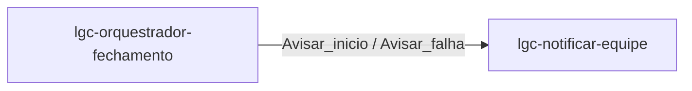

# Catálogo de automações
> Gerado em 25/11/2026 10:17 por código (`tools/catalogo_logicapps.py`). Operação dos últimos 30 dias até 25/11/2026. Logic Apps de exemplo e seus dados de operação são fictícios.

**6 Logic Apps:** 2 crítica(s), 1 com atenção, 2 ok, 1 sem dados de operação.

| Situação | Logic App | Dono | Quando roda | Execuções 30d | Falhas | Última execução | Conexões | Trata erro |
|---|---|---|---|---|---|---|---|---|
| Crítico | [[lgc-desvios-processo]] (exemplo) | time-processos | a cada 5 minutos — fuso E. South America Standard Time | 8.640 | 2.304 (26,7%) | 25/11/2026 (Failed) | Office 365 Outlook, SharePoint ⚠️ Error | não |
| Crítico | [[lgc-relatorio-custos]] (exemplo) | time-finops | todo dia, às 07:00 — fuso E. South America Standard Time | 30 | 4 (13,3%) | 25/11/2026 (Succeeded) | Office 365 Outlook | não |
| Atenção | [[lgc-chamados-nao-respondentes]] (exemplo) | **sem dono** | todo mês, às 09:00 (no dia 1) — fuso E. South America Standard Time | 1 | 0 (0,0%) | 01/11/2026 (Succeeded) | Excel Online (Business), Office 365 Outlook | sim |
| OK | [[lgc-notificar-equipe]] (exemplo) | time-automacao | sob demanda, quando receber uma chamada HTTP (POST) | 1 | 0 (0,0%) | 01/11/2026 (Succeeded) | Microsoft Teams | sim |
| OK | [[lgc-orquestrador-fechamento]] (exemplo) | time-automacao | todo mês, às 08:00 (no dia 1) — fuso E. South America Standard Time | 1 | 0 (0,0%) | 01/11/2026 (Succeeded) | - | sim |
| Sem dados | [[la-precos-logicapps]] | - | todo dia, às 08:00 — fuso E. South America Standard Time | - | - | -  | - | sim |

## O que precisa de ação
### lgc-desvios-processo — Crítico
- **[Alta] CONEXAO_COM_ERRO:** Uma conexão usada por esta Logic App está com erro no Azure. (SharePoint (Error: Unauthorized desde 18/11/2026)). *O que fazer:* Reautorizar a conexão (API connections > Edit API connection > Authorize) com a conta certa.
- **[Alta] FALHANDO:** 10% ou mais das execuções dos últimos 30 dias falharam. (2.304 de 8.640 execuções (26,7%), desde 18/11/2026. Causa provável: a ação `Obter_desvios_da_semana` usa a conexão SharePoint, que está com erro (Unauthorized)). *O que fazer:* Abrir a execução com falha no histórico, ver a ação em vermelho e corrigir a causa; depois reenviar.
- **[Média] RECORRENCIA_FREQUENTE** em `Recorrencia`: Gatilho roda com muita frequência (96 vezes por dia ou mais); cada execução e cada ação são cobradas. *O que fazer:* Ajustar a recorrência à necessidade real (ex.: relatório semanal → 1x por semana).
- **[Média] SEM_TRATAMENTO_DE_ERRO** em `(fluxo inteiro)`: Nenhuma ação roda após falha (runAfter Failed/TimedOut): erros passam em silêncio. *O que fazer:* Agrupar as ações num Escopo e adicionar uma ação de aviso com 'executar após' = Falhou/Tempo esgotado.

### lgc-relatorio-custos — Crítico
- **[Alta] FALHANDO:** 10% ou mais das execuções dos últimos 30 dias falharam. (4 de 30 execuções (13,3%), desde 04/11/2026. Causa provável: a ação `Chamar_function_de_custos` falhou com ServiceUnavailable (erro passageiro) e está sem retentativa: com a política padrão o Azure teria tentado de novo). *O que fazer:* Abrir a execução com falha no histórico, ver a ação em vermelho e corrigir a causa; depois reenviar.
- **[Alta] SEGREDO_NA_URL** em `Chamar_function_de_custos`: Chave/segredo exposto na URL de uma chamada HTTP (code=, sig=, key=). *O que fazer:* Guardar a chave no Azure Key Vault ou usar identidade gerenciada; nunca no JSON do fluxo.
- **[Média] SEM_RETENTATIVA** em `Chamar_function_de_custos`: Política de retentativa desligada (retryPolicy 'none'): falha passageira (408/429/5xx) derruba a execução. *O que fazer:* Remover o 'none' para voltar à política padrão (até 4 retentativas) ou definir uma política explícita.
- **[Média] SEM_TRATAMENTO_DE_ERRO** em `(fluxo inteiro)`: Nenhuma ação roda após falha (runAfter Failed/TimedOut): erros passam em silêncio. *O que fazer:* Agrupar as ações num Escopo e adicionar uma ação de aviso com 'executar após' = Falhou/Tempo esgotado.

### lgc-chamados-nao-respondentes — Atenção
- **[Média] SEM_DONO:** Sem a tag owner: ninguém é avisado quando quebrar. (tag owner ausente). *O que fazer:* Adicionar a tag owner com o time responsável.
- **[Baixa] DESTINATARIO_FIXO** em `Enviar_ranking_ao_coordenador`: Endereço de e-mail escrito direto na ação. *O que fazer:* Mover o destinatário para um parâmetro do fluxo (ou lista no SharePoint).

## Conexões
Uma conexão com erro derruba todas as Logic Apps que a usam.

| Conexão | Serviço | Status | Usada por |
|---|---|---|---|
| office365 — Office 365 (caixa automacoes@) | Office 365 Outlook | Connected | [[lgc-chamados-nao-respondentes]], [[lgc-desvios-processo]], [[lgc-relatorio-custos]] |
| excelonlinebusiness — Excel (conta de serviço) | Excel Online (Business) | Connected | [[lgc-chamados-nao-respondentes]] |
| sharepointonline — SharePoint (conta de serviço) | SharePoint | Error (Unauthorized desde 18/11/2026) | [[lgc-desvios-processo]] |
| teams — Teams (canal Automações) | Microsoft Teams | Connected | [[lgc-notificar-equipe]] |

## Quem chama quem

## Como ler
- **Crítico:** conexão com erro, 10% ou mais de falhas, parada, ou achado de severidade alta na definição.
- **Atenção:** sem dono, falhas pontuais, desabilitada, ou achado médio/baixo.
- **Sem dados:** a definição foi lida, mas falta a operação (rode `python tools/azure_logicapp.py sincronizar`).
- Execuções e falhas vêm das métricas RunsSucceeded e RunsFailed do Azure Monitor; conexões, do recurso Microsoft.Web/connections. Nada é alterado no Azure.

---
↩︎ [[INDICE Logic Apps]]
