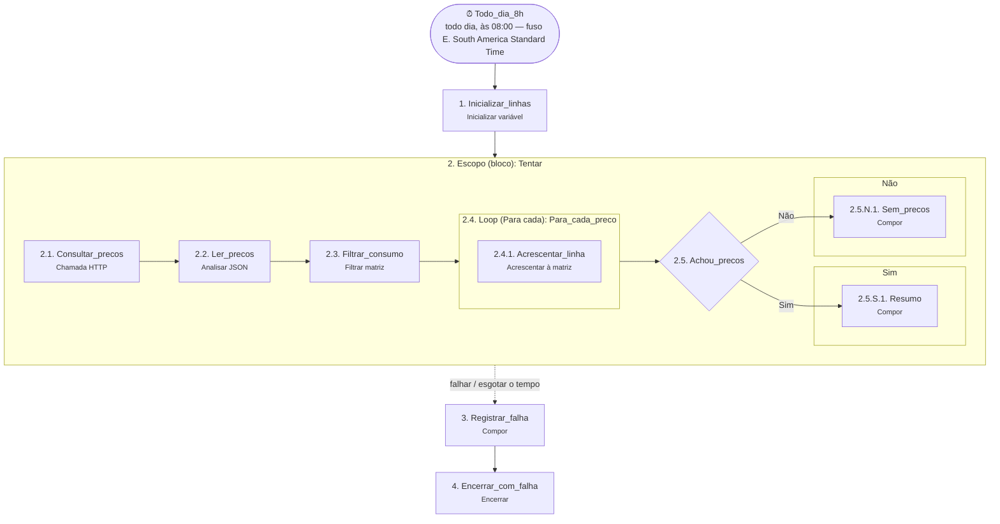

# Documentação — la-precos-logicapps
> Gerada automaticamente a partir de `logicapps/reais/la-precos-logicapps.json` em 11/11/2026 11:57:22. Conteúdo extraído do JSON por código (tools/logicapp_parser.py) e conferido por `tests/validar_docs.py`.

## Resumo
Roda todo dia, às 08:00 — fuso E. South America Standard Time. Usa nenhum conector gerenciado. Tem 12 ações e trata erros. Nenhum achado de boas práticas.

## Gatilho
| Nome | Tipo | Quando roda | Execuções/dia | Execuções/mês |
|---|---|---|---|---|
| Todo_dia_8h | Recorrência | todo dia, às 08:00 — fuso E. South America Standard Time | 1 | 30,42 |

## Fluxo

## Passo a passo
Ordem de execução lida do JSON. Números como `3.S.1` indicam: passo 3, ramo **S**im, 1ª ação do ramo (`N` = Não, `P` = Padrão, ou o nome do caso no Switch).

### 1. Inicializar_linhas — Inicializar variável
- **O que faz:** Cria a variável `linhas` (array) com valor inicial `[]`.
- **Quando roda:** logo no início, quando o gatilho dispara.

### 2. Tentar — Escopo (bloco)
- **O que faz:** Agrupa as ações de dentro. O resultado do bloco (sucesso ou falha) pode disparar ações seguintes.
- **Quando roda:** depois que `Inicializar_linhas` terminar com sucesso.
- **Quem usa o resultado:** `Registrar_falha`

#### 2.1. Consultar_precos — Chamada HTTP
- **O que faz:** Faz uma chamada HTTP **GET** para `https://prices.azure.com/api/retail/prices` com os parâmetros: currencyCode = `'BRL'`; $filter = `serviceName eq 'Logic Apps' and armRegionName eq '@{parameters('regiao')}' and type eq 'C…`.
- **Quando roda:** no início do bloco `Tentar`.
- **Dentro de:** `Tentar`
- **Usa dados de:** parâmetro `regiao`
- **Quem usa o resultado:** `Ler_precos`
- **Retentativa:** intervalo exponencial, 3 tentativa(s), intervalo PT10S

#### 2.2. Ler_precos — Analisar JSON
- **O que faz:** Lê o JSON de `@body('Consultar_precos')` e expõe os campos: Items (array), Count (integer).
- **Quando roda:** depois que `Consultar_precos` terminar com sucesso.
- **Dentro de:** `Tentar`
- **Usa dados de:** saída de `Consultar_precos`
- **Quem usa o resultado:** `Filtrar_consumo`

#### 2.3. Filtrar_consumo — Filtrar matriz
- **O que faz:** Filtra a lista `@body('Ler_precos')?['Items']` mantendo os itens em que `@startsWith(item()?['meterName'], 'Consumption ')`.
- **Quando roda:** depois que `Ler_precos` terminar com sucesso.
- **Dentro de:** `Tentar`
- **Usa dados de:** saída de `Ler_precos`, cada item da própria lista
- **Quem usa o resultado:** `Para_cada_preco`

#### 2.4. Para_cada_preco — Loop (Para cada)
- **O que faz:** Repete as ações de dentro para cada item de `@body('Filtrar_consumo')`, um item por vez (sequencial).
- **Quando roda:** depois que `Filtrar_consumo` terminar com sucesso.
- **Dentro de:** `Tentar`
- **Usa dados de:** saída de `Filtrar_consumo`

##### 2.4.1. Acrescentar_linha — Acrescentar à matriz
- **O que faz:** Acrescenta `{"medidor": "@items('Para_cada_preco')?['meterName']", "preco": "@items('Para_c…` ao fim da lista na variável `linhas`.
- **Quando roda:** no início do bloco `Para_cada_preco`.
- **Dentro de:** `Para_cada_preco`
- **Usa dados de:** item atual do loop `Para_cada_preco`

#### 2.5. Achou_precos — Condição
- **O que faz:** Verifica a condição `(@length(variables('linhas')) > 0)`. Se verdadeira, segue o ramo **Sim**; senão, o ramo **Não**.
- **Quando roda:** depois que `Para_cada_preco` terminar com sucesso.
- **Dentro de:** `Tentar`
- **Usa dados de:** variável `linhas`

##### 2.5.S.1. Resumo — Compor
- **O que faz:** Monta um valor a partir de: `{"consultado_em": "@{utcNow()}", "regiao": "@{parameters('regiao')}", "moeda": "BRL", "fonte": "https://prices.azure.co…`.
- **Quando roda:** no início do bloco `Achou_precos` (ramo Sim).
- **Dentro de:** `Achou_precos` → ramo Sim
- **Usa dados de:** parâmetro `regiao`, variável `linhas`

##### 2.5.N.1. Sem_precos — Compor
- **O que faz:** Monta um valor a partir de: `A API não retornou preços de Logic Apps para a região @{parameters('regiao')}`.
- **Quando roda:** no início do bloco `Achou_precos` (ramo Não).
- **Dentro de:** `Achou_precos` → ramo Não
- **Usa dados de:** parâmetro `regiao`

### 3. Registrar_falha — Compor
- **O que faz:** Monta um valor a partir de: `@result('Tentar')`.
- **Quando roda:** depois que `Tentar` falhar ou esgotar o tempo.
- **Usa dados de:** saída de `Tentar`

### 4. Encerrar_com_falha — Encerrar
- **O que faz:** Encerra a execução com status **Failed** e a mensagem “Não foi possível consultar a API de preços do Azure.”.
- **Quando roda:** depois que `Registrar_falha` terminar com sucesso.

## Variáveis
| Variável | Tipo | Valor inicial | Criada em | Alterada em |
|---|---|---|---|---|
| linhas | array | `[]` | Inicializar_linhas | Acrescentar_linha |

## Parâmetros
| Nome | Tipo | Valor padrão |
|---|---|---|
| regiao | String | brazilsouth |

## Custo (execuções cobradas)
No plano Consumption, cada execução de gatilho e de ação é medida; dentro de loop, cada volta conta ([Microsoft Learn](https://learn.microsoft.com/azure/logic-apps/logic-apps-pricing)).

| Item | Valor |
|---|---|
| Ações por execução (fora de loops; em condições, o ramo mais longo) | 8 (conector gerenciado: 0) |
| Ações a cada item/volta de `Para_cada_preco` | 1 |
| Só rodam se algo falhar (não entram na conta) | Encerrar_com_falha, Registrar_falha |
| Execuções do gatilho por mês | 30,42 |
| Ações fixas por mês (execuções × ações fixas) | 243,33 + as dos loops |

## Ações
| # | Ação | Tipo | Conector | Dentro de | Executa após |
|---|---|---|---|---|---|
| 1 | Inicializar_linhas | Inicializar variável | - | - | início do bloco |
| 2 | Tentar | Escopo (bloco) | - | - | Inicializar_linhas (Succeeded) |
| 2.1 | Consultar_precos | Chamada HTTP | - | Tentar | início do bloco |
| 2.2 | Ler_precos | Analisar JSON | - | Tentar | Consultar_precos (Succeeded) |
| 2.3 | Filtrar_consumo | Filtrar matriz | - | Tentar | Ler_precos (Succeeded) |
| 2.4 | Para_cada_preco | Loop (Para cada) | - | Tentar | Filtrar_consumo (Succeeded) |
| 2.4.1 | Acrescentar_linha | Acrescentar à matriz | - | Para_cada_preco | início do bloco |
| 2.5 | Achou_precos | Condição | - | Tentar | Para_cada_preco (Succeeded) |
| 2.5.S.1 | Resumo | Compor | - | Achou_precos → Sim | início do bloco |
| 2.5.N.1 | Sem_precos | Compor | - | Achou_precos → Não | início do bloco |
| 3 | Registrar_falha | Compor | - | - | Tentar (Failed, TimedOut) |
| 4 | Encerrar_com_falha | Encerrar | - | - | Registrar_falha (Succeeded) |

## Achados de boas práticas
Nenhum achado.

---
↩︎ [[INDICE Logic Apps]]
