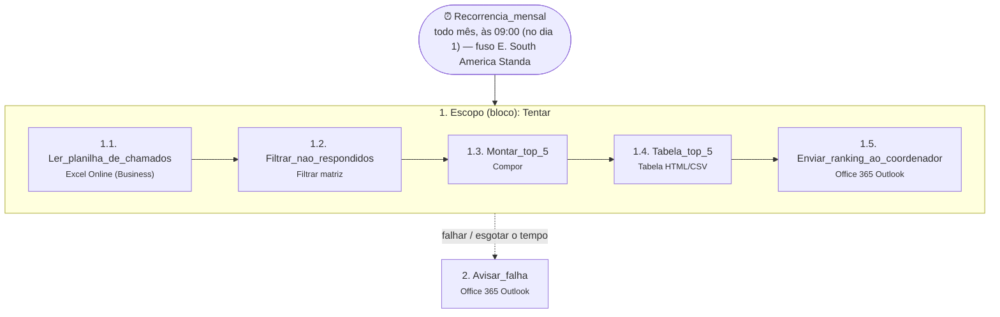

# Documentação — lgc-chamados-nao-respondentes
> Gerada automaticamente a partir de `logicapps/exemplos/lgc-chamados-nao-respondentes.json` em 11/11/2026 11:57:22. Conteúdo extraído do JSON por código (tools/logicapp_parser.py) e conferido por `tests/validar_docs.py`. Exemplo fictício.

## Resumo
Roda todo mês, às 09:00 (no dia 1) — fuso E. South America Standard Time. Usa Excel Online (Business), Office 365 Outlook. Tem 7 ações e trata erros. Achados de boas práticas: **1**.

## Gatilho
| Nome | Tipo | Quando roda | Execuções/dia | Execuções/mês |
|---|---|---|---|---|
| Recorrencia_mensal | Recorrência | todo mês, às 09:00 (no dia 1) — fuso E. South America Standard Time | 0,03 | 1 |

## Fluxo

## Passo a passo
Ordem de execução lida do JSON. Números como `3.S.1` indicam: passo 3, ramo **S**im, 1ª ação do ramo (`N` = Não, `P` = Padrão, ou o nome do caso no Switch).

### 1. Tentar — Escopo (bloco)
- **O que faz:** Agrupa as ações de dentro. O resultado do bloco (sucesso ou falha) pode disparar ações seguintes.
- **Quando roda:** logo no início, quando o gatilho dispara.
- **Quem usa o resultado:** `Avisar_falha`

#### 1.1. Ler_planilha_de_chamados — Conector gerenciado
- **O que faz:** Usa o conector **Excel Online (Business)** para: Obter itens da tabela 'Tabela1'.
- **Quando roda:** no início do bloco `Tentar`.
- **Dentro de:** `Tentar`
- **Quem usa o resultado:** `Filtrar_nao_respondidos`

#### 1.2. Filtrar_nao_respondidos — Filtrar matriz
- **O que faz:** Filtra a lista `@body('Ler_planilha_de_chamados')?['value']` mantendo os itens em que `@equals(item()?['Respondido'], 'Nao')`.
- **Quando roda:** depois que `Ler_planilha_de_chamados` terminar com sucesso.
- **Dentro de:** `Tentar`
- **Usa dados de:** saída de `Ler_planilha_de_chamados`, cada item da própria lista
- **Quem usa o resultado:** `Montar_top_5`

#### 1.3. Montar_top_5 — Compor
- **O que faz:** Monta um valor a partir de: `@take(body('Filtrar_nao_respondidos'), 5)`.
- **Quando roda:** depois que `Filtrar_nao_respondidos` terminar com sucesso.
- **Dentro de:** `Tentar`
- **Usa dados de:** saída de `Filtrar_nao_respondidos`
- **Quem usa o resultado:** `Tabela_top_5`

#### 1.4. Tabela_top_5 — Tabela HTML/CSV
- **O que faz:** Cria uma tabela HTML a partir de `@outputs('Montar_top_5')` (colunas: automáticas).
- **Quando roda:** depois que `Montar_top_5` terminar com sucesso.
- **Dentro de:** `Tentar`
- **Usa dados de:** saída de `Montar_top_5`
- **Quem usa o resultado:** `Enviar_ranking_ao_coordenador`

#### 1.5. Enviar_ranking_ao_coordenador — Conector gerenciado
- **O que faz:** Usa o conector **Office 365 Outlook** para: Enviar um e-mail (V2). Para: `coordenador@empresa-exemplo.com`; assunto: “Top 5 — chamados não respondidos no mês”.
- **Quando roda:** depois que `Tabela_top_5` terminar com sucesso.
- **Dentro de:** `Tentar`
- **Usa dados de:** saída de `Tabela_top_5`

### 2. Avisar_falha — Conector gerenciado
- **O que faz:** Usa o conector **Office 365 Outlook** para: Enviar um e-mail (V2). Para: `@{parameters('emailSuporte')}`; assunto: “Falha na automação de chamados”.
- **Quando roda:** depois que `Tentar` falhar ou esgotar o tempo.
- **Usa dados de:** saída de `Tentar`, parâmetro `emailSuporte`

## Parâmetros
| Nome | Tipo | Valor padrão |
|---|---|---|
| siteUrl | String | https://exemplo.sharepoint.com/sites/demo |
| emailSuporte | String | suporte-automacao@empresa-exemplo.com |

## Custo (execuções cobradas)
No plano Consumption, cada execução de gatilho e de ação é medida; dentro de loop, cada volta conta ([Microsoft Learn](https://learn.microsoft.com/azure/logic-apps/logic-apps-pricing)).

| Item | Valor |
|---|---|
| Ações por execução (fora de loops; em condições, o ramo mais longo) | 6 (conector gerenciado: 2) |
| Só rodam se algo falhar (não entram na conta) | Avisar_falha |
| Execuções do gatilho por mês | 1 |
| Ações fixas por mês (execuções × ações fixas) | 6 |

## Ações
| # | Ação | Tipo | Conector | Dentro de | Executa após |
|---|---|---|---|---|---|
| 1 | Tentar | Escopo (bloco) | - | - | início do bloco |
| 1.1 | Ler_planilha_de_chamados | Conector gerenciado | Excel Online (Business) | Tentar | início do bloco |
| 1.2 | Filtrar_nao_respondidos | Filtrar matriz | - | Tentar | Ler_planilha_de_chamados (Succeeded) |
| 1.3 | Montar_top_5 | Compor | - | Tentar | Filtrar_nao_respondidos (Succeeded) |
| 1.4 | Tabela_top_5 | Tabela HTML/CSV | - | Tentar | Montar_top_5 (Succeeded) |
| 1.5 | Enviar_ranking_ao_coordenador | Conector gerenciado | Office 365 Outlook | Tentar | Tabela_top_5 (Succeeded) |
| 2 | Avisar_falha | Conector gerenciado | Office 365 Outlook | - | Tentar (Failed, TimedOut) |

## Achados de boas práticas
| Severidade | Regra | Categoria | Onde | Detalhe | Recomendação |
|---|---|---|---|---|---|
| Baixa | DESTINATARIO_FIXO | Manutenção | Enviar_ranking_ao_coordenador | Endereço de e-mail escrito direto na ação. (To: coordenador@empresa-exemplo.com) | Mover o destinatário para um parâmetro do fluxo (ou lista no SharePoint). |

---
↩︎ [[INDICE Logic Apps]]
