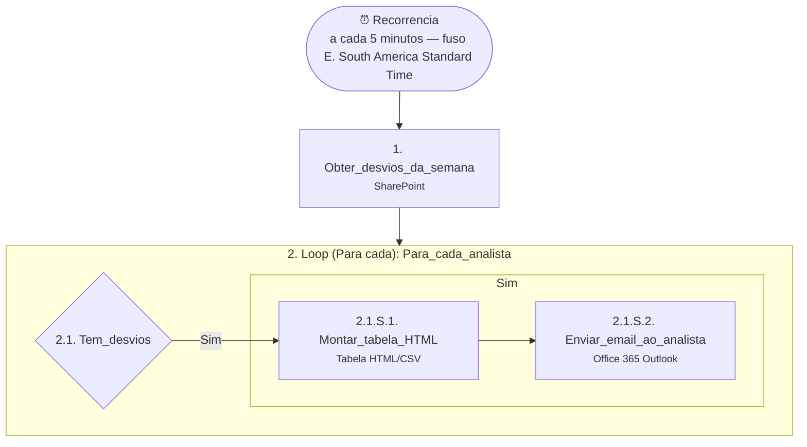

# Documentação — lgc-desvios-processo
> Gerada automaticamente a partir de `logicapps/exemplos/lgc-desvios-processo.json` em 25/11/2026 10:17:36. Conteúdo extraído do JSON por código (tools/logicapp_parser.py) e conferido por `tests/validar_docs.py`. Exemplo fictício.

## Resumo
Roda a cada 5 minutos — fuso E. South America Standard Time. Usa Office 365 Outlook, SharePoint. Tem 5 ações e **não trata erros**. Achados de boas práticas: **2**.

## Gatilho
| Nome | Tipo | Quando roda | Execuções/dia | Execuções/mês |
|---|---|---|---|---|
| Recorrencia | Recorrência | a cada 5 minutos — fuso E. South America Standard Time | 288 | 8.760 |

## Fluxo

## Passo a passo
Ordem de execução lida do JSON. Números como `3.S.1` indicam: passo 3, ramo **S**im, 1ª ação do ramo (`N` = Não, `P` = Padrão, ou o nome do caso no Switch).

### 1. Obter_desvios_da_semana — Conector gerenciado
- **O que faz:** Usa o conector **SharePoint** para: Obter itens da lista 'Desvios de Processo - Demo'.
- **Quando roda:** logo no início, quando o gatilho dispara.
- **Usa dados de:** parâmetro `siteUrl`
- **Quem usa o resultado:** `Para_cada_analista`

### 2. Para_cada_analista — Loop (Para cada)
- **O que faz:** Repete as ações de dentro para cada item de `@body('Obter_desvios_da_semana')?['value']`, vários itens ao mesmo tempo (paralelo).
- **Quando roda:** depois que `Obter_desvios_da_semana` terminar com sucesso.
- **Usa dados de:** saída de `Obter_desvios_da_semana`

#### 2.1. Tem_desvios — Condição
- **O que faz:** Verifica a condição `(@length(item()?['Desvios']) > 0)`. Se verdadeira, segue o ramo **Sim**; senão, o ramo **Não**.
- **Quando roda:** no início do bloco `Para_cada_analista`.
- **Dentro de:** `Para_cada_analista`
- **Usa dados de:** item atual do loop `Para_cada_analista`

##### 2.1.S.1. Montar_tabela_HTML — Tabela HTML/CSV
- **O que faz:** Cria uma tabela HTML a partir de `@item()?['Desvios']` (colunas: automáticas).
- **Quando roda:** no início do bloco `Tem_desvios` (ramo Sim).
- **Dentro de:** `Tem_desvios` → ramo Sim
- **Usa dados de:** item atual do loop `Para_cada_analista`
- **Quem usa o resultado:** `Enviar_email_ao_analista`

##### 2.1.S.2. Enviar_email_ao_analista — Conector gerenciado
- **O que faz:** Usa o conector **Office 365 Outlook** para: Enviar um e-mail (V2). Para: `@{item()?['EmailAnalista']}`; assunto: “Seus desvios de processo da semana”.
- **Quando roda:** depois que `Montar_tabela_HTML` terminar com sucesso.
- **Dentro de:** `Tem_desvios` → ramo Sim
- **Usa dados de:** saída de `Montar_tabela_HTML`, item atual do loop `Para_cada_analista`

## Parâmetros
| Nome | Tipo | Valor padrão |
|---|---|---|
| siteUrl | String | https://exemplo.sharepoint.com/sites/demo |

## Custo (execuções cobradas)
No plano Consumption, cada execução de gatilho e de ação é medida; dentro de loop, cada volta conta ([Microsoft Learn](https://learn.microsoft.com/azure/logic-apps/logic-apps-pricing)).

| Item | Valor |
|---|---|
| Ações por execução (fora de loops; em condições, o ramo mais longo) | 2 (conector gerenciado: 1) |
| Ações a cada item/volta de `Para_cada_analista` | 3 |
| Execuções do gatilho por mês | 8.760 |
| Ações fixas por mês (execuções × ações fixas) | 17.520 + as dos loops |

## Conexões
Conexões são recursos separados no Azure (Microsoft.Web/connections); uma conexão com erro derruba todas as ações que a usam ([Microsoft Learn](https://learn.microsoft.com/azure/logic-apps/manage-logic-apps-with-azure-portal#view-connections)).

| Chave no fluxo | Serviço | Recurso de conexão | Ações que usam | Status | Também usada por |
|---|---|---|---|---|---|
| office365 | Office 365 Outlook | office365 | Enviar_email_ao_analista | Connected | [[lgc-chamados-nao-respondentes]], [[lgc-relatorio-custos]] |
| sharepointonline | SharePoint | sharepointonline | Obter_desvios_da_semana | Error (Unauthorized desde 18/11/2026) | - |

## Dependências
O fluxo precisa destes serviços de pé:

- `Obter_desvios_da_semana` → conector SharePoint (conexão `sharepointonline`)
- `Enviar_email_ao_analista` → conector Office 365 Outlook (conexão `office365`)

## Tratamento de erro
- **Nenhuma ação trata falha:** se algo der errado, a execução termina como Falhou e ninguém é avisado.
- Retentativa: todas as ações usam a política padrão (até 4 novas tentativas em erros 408, 429 e 5xx).
- Referência: [tratar erros e exceções](https://learn.microsoft.com/azure/logic-apps/error-exception-handling).

## Runbook: quando falhar
1. **Ver o erro:** portal do Azure > Logic App `lgc-desvios-processo` > Visão geral (Overview) > Histórico de execuções (Runs history) > abrir a execução com falha. A ação em vermelho mostra o código e a mensagem ([Microsoft Learn](https://learn.microsoft.com/azure/logic-apps/view-workflow-status-run-history)).
2. **Identificar a causa pelo código:**
   - **401/403 (não autorizado/proibido):** conexão expirada ou sem permissão. Logic App > Conexões de API (API connections) > a conexão > Editar conexão de API (Edit API connection) > autorizar de novo com a conta certa. Conexões deste fluxo: Office 365 Outlook, SharePoint.
   - **404 (não encontrado):** lista, arquivo, caixa ou endereço foi renomeado ou apagado; ajustar a ação.
   - **408, 429 ou 5xx (passageiro):** costuma resolver sozinho; com a retentativa padrão o Azure tenta de novo até 4 vezes.
   - Pontos que dependem de fora (os primeiros a conferir): `Obter_desvios_da_semana` (conector SharePoint (conexão `sharepointonline`)); `Enviar_email_ao_analista` (conector Office 365 Outlook (conexão `office365`)).
3. **Reenviar depois de corrigir:** na execução com falha, **Reenviar** (Resubmit) roda o fluxo inteiro de novo com as mesmas entradas e a mesma versão do fluxo, ou **Enviar a partir desta ação** (Submit from this action) para recomeçar do ponto da falha (não vale para ações dentro de loops e de ramos de condição).
   - **Cuidado, reenviar repete:** `Enviar_email_ao_analista` (Office 365 Outlook (POST)). Confira se isso já aconteceu na execução que falhou para não duplicar.
4. **Quem acionar:** dono `time-processos` (tag owner).

### Situação atual (dados de operação fictícios)
- **Crítico** · 8.640 execução(ões) nos últimos 30 dias, 2.304 com falha · última em 25/11/2026 (Failed).
- CONEXAO_COM_ERRO (Alta): SharePoint (Error: Unauthorized desde 18/11/2026)
- FALHANDO (Alta): 2.304 de 8.640 execuções (26,7%), desde 18/11/2026. Causa provável: a ação `Obter_desvios_da_semana` usa a conexão SharePoint, que está com erro (Unauthorized)

## Ações
| # | Ação | Tipo | Conector | Dentro de | Executa após |
|---|---|---|---|---|---|
| 1 | Obter_desvios_da_semana | Conector gerenciado | SharePoint | - | início do bloco |
| 2 | Para_cada_analista | Loop (Para cada) | - | - | Obter_desvios_da_semana (Succeeded) |
| 2.1 | Tem_desvios | Condição | - | Para_cada_analista | início do bloco |
| 2.1.S.1 | Montar_tabela_HTML | Tabela HTML/CSV | - | Tem_desvios → Sim | início do bloco |
| 2.1.S.2 | Enviar_email_ao_analista | Conector gerenciado | Office 365 Outlook | Tem_desvios → Sim | Montar_tabela_HTML (Succeeded) |

## Achados de boas práticas
| Severidade | Regra | Categoria | Onde | Detalhe | Recomendação |
|---|---|---|---|---|---|
| Média | RECORRENCIA_FREQUENTE | Custo | Recorrencia | Gatilho roda com muita frequência (96 vezes por dia ou mais); cada execução e cada ação são cobradas. (288 execuções por dia) | Ajustar a recorrência à necessidade real (ex.: relatório semanal → 1x por semana). |
| Média | SEM_TRATAMENTO_DE_ERRO | Confiabilidade | (fluxo inteiro) | Nenhuma ação roda após falha (runAfter Failed/TimedOut): erros passam em silêncio. (nenhum runAfter com Failed/TimedOut) | Agrupar as ações num Escopo e adicionar uma ação de aviso com 'executar após' = Falhou/Tempo esgotado. |

---
↩︎ [[INDICE Logic Apps]]
