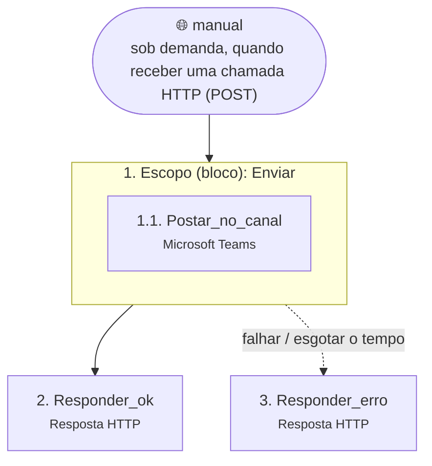

# Documentação — lgc-notificar-equipe
> Gerada automaticamente a partir de `logicapps/exemplos/lgc-notificar-equipe.json` em 25/11/2026 10:17:36. Conteúdo extraído do JSON por código (tools/logicapp_parser.py) e conferido por `tests/validar_docs.py`. Exemplo fictício.

## Resumo
Roda sob demanda, quando receber uma chamada HTTP (POST). Usa Microsoft Teams. Tem 4 ações e trata erros. Nenhum achado de boas práticas.

## Gatilho
| Nome | Tipo | Quando roda | Execuções/dia | Execuções/mês |
|---|---|---|---|---|
| manual | Requisição HTTP (manual) | sob demanda, quando receber uma chamada HTTP (POST) | - | - |

- Campos esperados na chamada: `mensagem`, `titulo`

## Fluxo

## Passo a passo
Ordem de execução lida do JSON. Números como `3.S.1` indicam: passo 3, ramo **S**im, 1ª ação do ramo (`N` = Não, `P` = Padrão, ou o nome do caso no Switch).

### 1. Enviar — Escopo (bloco)
- **O que faz:** Agrupa as ações de dentro. O resultado do bloco (sucesso ou falha) pode disparar ações seguintes.
- **Quando roda:** logo no início, quando o gatilho dispara.

#### 1.1. Postar_no_canal — Conector gerenciado
- **O que faz:** Usa o conector **Microsoft Teams** para: POST /v1.0/teams/{parâmetro equipeId}/channels/{parâmetro canalId}/messages.
- **Quando roda:** no início do bloco `Enviar`.
- **Dentro de:** `Enviar`
- **Usa dados de:** dados recebidos pelo gatilho, parâmetro `canalId`, parâmetro `equipeId`

### 2. Responder_ok — Resposta HTTP
- **O que faz:** Responde à chamada HTTP que iniciou o fluxo com o status **200**.
- **Quando roda:** depois que `Enviar` terminar com sucesso.

### 3. Responder_erro — Resposta HTTP
- **O que faz:** Responde à chamada HTTP que iniciou o fluxo com o status **500**.
- **Quando roda:** depois que `Enviar` falhar ou esgotar o tempo.

## Parâmetros
| Nome | Tipo | Valor padrão |
|---|---|---|
| equipeId | String | 11111111-aaaa-bbbb-cccc-000000000000 |
| canalId | String | 19:canal-automacoes-demo@thread.tacv2 |

## Custo (execuções cobradas)
No plano Consumption, cada execução de gatilho e de ação é medida; dentro de loop, cada volta conta ([Microsoft Learn](https://learn.microsoft.com/azure/logic-apps/logic-apps-pricing)).

| Item | Valor |
|---|---|
| Ações por execução (fora de loops; em condições, o ramo mais longo) | 3 (conector gerenciado: 1) |
| Só rodam se algo falhar (não entram na conta) | Responder_erro |

## Conexões
Conexões são recursos separados no Azure (Microsoft.Web/connections); uma conexão com erro derruba todas as ações que a usam ([Microsoft Learn](https://learn.microsoft.com/azure/logic-apps/manage-logic-apps-with-azure-portal#view-connections)).

| Chave no fluxo | Serviço | Recurso de conexão | Ações que usam | Status | Também usada por |
|---|---|---|---|---|---|
| teams | Microsoft Teams | teams | Postar_no_canal | Connected | - |

## Dependências
O fluxo precisa destes serviços de pé:

- `Postar_no_canal` → conector Microsoft Teams (conexão `teams`)
- **É chamada por:** [[lgc-orquestrador-fechamento]]. Se esta parar, elas falham.

## Tratamento de erro
- `Responder_erro` roda se `Enviar` falhar ou esgotar o tempo (cobre 2 ação(ões): Enviar, Postar_no_canal).
- Fora da proteção (uma falha nelas não aciona o tratamento): `Responder_ok`
- Retentativa: todas as ações usam a política padrão (até 4 novas tentativas em erros 408, 429 e 5xx).
- Referência: [tratar erros e exceções](https://learn.microsoft.com/azure/logic-apps/error-exception-handling).

## Runbook: quando falhar
1. **Ver o erro:** portal do Azure > Logic App `lgc-notificar-equipe` > Visão geral (Overview) > Histórico de execuções (Runs history) > abrir a execução com falha. A ação em vermelho mostra o código e a mensagem ([Microsoft Learn](https://learn.microsoft.com/azure/logic-apps/view-workflow-status-run-history)).
2. **Identificar a causa pelo código:**
   - **401/403 (não autorizado/proibido):** conexão expirada ou sem permissão. Logic App > Conexões de API (API connections) > a conexão > Editar conexão de API (Edit API connection) > autorizar de novo com a conta certa. Conexões deste fluxo: Microsoft Teams.
   - **404 (não encontrado):** lista, arquivo, caixa ou endereço foi renomeado ou apagado; ajustar a ação.
   - **408, 429 ou 5xx (passageiro):** costuma resolver sozinho; com a retentativa padrão o Azure tenta de novo até 4 vezes.
   - Pontos que dependem de fora (os primeiros a conferir): `Postar_no_canal` (conector Microsoft Teams (conexão `teams`)).
3. **Reenviar depois de corrigir:** na execução com falha, **Reenviar** (Resubmit) roda o fluxo inteiro de novo com as mesmas entradas e a mesma versão do fluxo, ou **Enviar a partir desta ação** (Submit from this action) para recomeçar do ponto da falha (não vale para ações dentro de loops e de ramos de condição).
   - **Cuidado, reenviar repete:** `Postar_no_canal` (Microsoft Teams (POST)). Confira se isso já aconteceu na execução que falhou para não duplicar.
4. **Quem acionar:** dono `time-automacao` (tag owner).
   - Avise também quem usa esta Logic App: [[lgc-orquestrador-fechamento]].

### Situação atual (dados de operação fictícios)
- **OK** · 1 execução(ões) nos últimos 30 dias, 0 com falha · última em 01/11/2026 (Succeeded).

## Ações
| # | Ação | Tipo | Conector | Dentro de | Executa após |
|---|---|---|---|---|---|
| 1 | Enviar | Escopo (bloco) | - | - | início do bloco |
| 1.1 | Postar_no_canal | Conector gerenciado | Microsoft Teams | Enviar | início do bloco |
| 2 | Responder_ok | Resposta HTTP | - | - | Enviar (Succeeded) |
| 3 | Responder_erro | Resposta HTTP | - | - | Enviar (Failed, TimedOut) |

## Achados de boas práticas
Nenhum achado.

---
↩︎ [[INDICE Logic Apps]]
