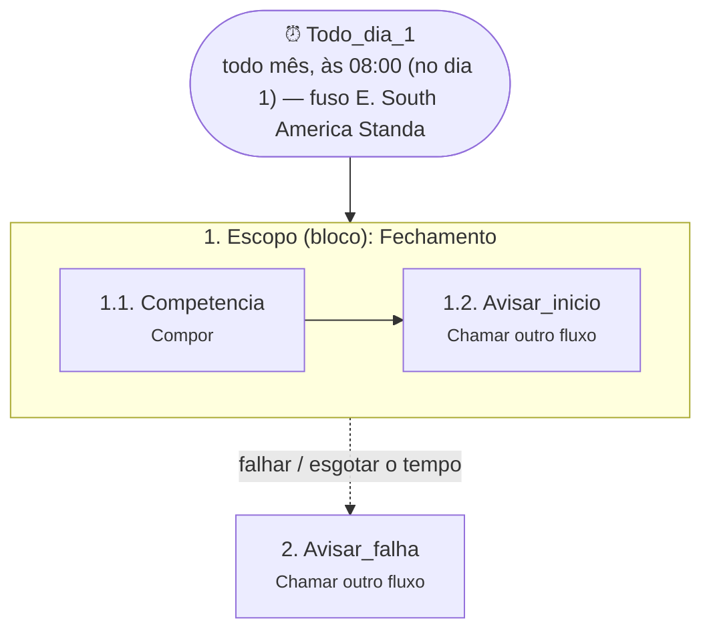

# Documentação — lgc-orquestrador-fechamento
> Gerada automaticamente a partir de `logicapps/exemplos/lgc-orquestrador-fechamento.json` em 25/11/2026 10:17:36. Conteúdo extraído do JSON por código (tools/logicapp_parser.py) e conferido por `tests/validar_docs.py`. Exemplo fictício.

## Resumo
Roda todo mês, às 08:00 (no dia 1) — fuso E. South America Standard Time. Usa nenhum conector gerenciado. Tem 4 ações e trata erros. Nenhum achado de boas práticas.

## Gatilho
| Nome | Tipo | Quando roda | Execuções/dia | Execuções/mês |
|---|---|---|---|---|
| Todo_dia_1 | Recorrência | todo mês, às 08:00 (no dia 1) — fuso E. South America Standard Time | 0,03 | 1 |

## Fluxo

## Passo a passo
Ordem de execução lida do JSON. Números como `3.S.1` indicam: passo 3, ramo **S**im, 1ª ação do ramo (`N` = Não, `P` = Padrão, ou o nome do caso no Switch).

### 1. Fechamento — Escopo (bloco)
- **O que faz:** Agrupa as ações de dentro. O resultado do bloco (sucesso ou falha) pode disparar ações seguintes.
- **Quando roda:** logo no início, quando o gatilho dispara.

#### 1.1. Competencia — Compor
- **O que faz:** Monta um valor a partir de: `@{formatDateTime(addDays(startOfMonth(utcNow()), -1), 'MM/yyyy')}`.
- **Quando roda:** no início do bloco `Fechamento`.
- **Dentro de:** `Fechamento`
- **Quem usa o resultado:** `Avisar_inicio`

#### 1.2. Avisar_inicio — Chamar outro fluxo
- **O que faz:** Chama outro fluxo (Logic App filha) `lgc-notificar-equipe`.
- **Quando roda:** depois que `Competencia` terminar com sucesso.
- **Dentro de:** `Fechamento`
- **Usa dados de:** saída de `Competencia`

### 2. Avisar_falha — Chamar outro fluxo
- **O que faz:** Chama outro fluxo (Logic App filha) `lgc-notificar-equipe`.
- **Quando roda:** depois que `Fechamento` falhar ou esgotar o tempo.

## Parâmetros
Nenhum parâmetro além das conexões.

## Custo (execuções cobradas)
No plano Consumption, cada execução de gatilho e de ação é medida; dentro de loop, cada volta conta ([Microsoft Learn](https://learn.microsoft.com/azure/logic-apps/logic-apps-pricing)).

| Item | Valor |
|---|---|
| Ações por execução (fora de loops; em condições, o ramo mais longo) | 3 (conector gerenciado: 0) |
| Só rodam se algo falhar (não entram na conta) | Avisar_falha |
| Execuções do gatilho por mês | 1 |
| Ações fixas por mês (execuções × ações fixas) | 3 |

## Conexões
Nenhuma conexão gerenciada: usa só ações nativas.

## Dependências
O fluxo precisa destes serviços de pé:

- `Avisar_inicio` → Logic App `lgc-notificar-equipe`
- `Avisar_falha` → Logic App `lgc-notificar-equipe`
- **Chama:** [[lgc-notificar-equipe]]. Se ela falhar, esta também é afetada.

## Tratamento de erro
- `Avisar_falha` roda se `Fechamento` falhar ou esgotar o tempo (cobre 3 ação(ões): Avisar_inicio, Competencia, Fechamento).
- Retentativa: todas as ações usam a política padrão (até 4 novas tentativas em erros 408, 429 e 5xx).
- Referência: [tratar erros e exceções](https://learn.microsoft.com/azure/logic-apps/error-exception-handling).

## Runbook: quando falhar
1. **Ver o erro:** portal do Azure > Logic App `lgc-orquestrador-fechamento` > Visão geral (Overview) > Histórico de execuções (Runs history) > abrir a execução com falha. A ação em vermelho mostra o código e a mensagem ([Microsoft Learn](https://learn.microsoft.com/azure/logic-apps/view-workflow-status-run-history)).
2. **Identificar a causa pelo código:**
   - **401/403 (não autorizado/proibido):** conexão expirada ou sem permissão. Logic App > Conexões de API (API connections) > a conexão > Editar conexão de API (Edit API connection) > autorizar de novo com a conta certa.
   - **404 (não encontrado):** lista, arquivo, caixa ou endereço foi renomeado ou apagado; ajustar a ação.
   - **408, 429 ou 5xx (passageiro):** costuma resolver sozinho; com a retentativa padrão o Azure tenta de novo até 4 vezes.
   - Pontos que dependem de fora (os primeiros a conferir): `Avisar_inicio` (Logic App `lgc-notificar-equipe`); `Avisar_falha` (Logic App `lgc-notificar-equipe`).
3. **Reenviar depois de corrigir:** na execução com falha, **Reenviar** (Resubmit) roda o fluxo inteiro de novo com as mesmas entradas e a mesma versão do fluxo, ou **Enviar a partir desta ação** (Submit from this action) para recomeçar do ponto da falha (não vale para ações dentro de loops e de ramos de condição).
   - **Cuidado, reenviar repete:** `Avisar_inicio` (chama a Logic App `lgc-notificar-equipe`); `Avisar_falha` (chama a Logic App `lgc-notificar-equipe`). Confira se isso já aconteceu na execução que falhou para não duplicar.
4. **Quem acionar:** dono `time-automacao` (tag owner).

### Situação atual (dados de operação fictícios)
- **OK** · 1 execução(ões) nos últimos 30 dias, 0 com falha · última em 01/11/2026 (Succeeded).

## Ações
| # | Ação | Tipo | Conector | Dentro de | Executa após |
|---|---|---|---|---|---|
| 1 | Fechamento | Escopo (bloco) | - | - | início do bloco |
| 1.1 | Competencia | Compor | - | Fechamento | início do bloco |
| 1.2 | Avisar_inicio | Chamar outro fluxo | - | Fechamento | Competencia (Succeeded) |
| 2 | Avisar_falha | Chamar outro fluxo | - | - | Fechamento (Failed, TimedOut) |

## Achados de boas práticas
Nenhum achado.

---
↩︎ [[INDICE Logic Apps]]
