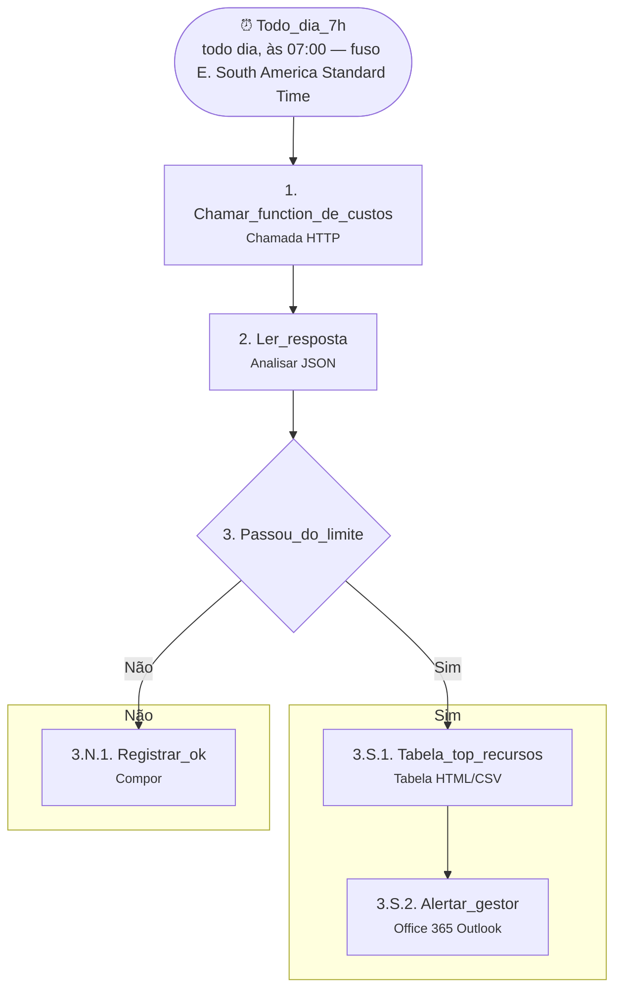

# Documentação — lgc-relatorio-custos
> Gerada automaticamente a partir de `logicapps/exemplos/lgc-relatorio-custos.json` em 11/11/2026 11:57:22. Conteúdo extraído do JSON por código (tools/logicapp_parser.py) e conferido por `tests/validar_docs.py`. Exemplo fictício.

## Resumo
Roda todo dia, às 07:00 — fuso E. South America Standard Time. Usa Office 365 Outlook. Tem 6 ações e **não trata erros**. Achados de boas práticas: **3**.

## Gatilho
| Nome | Tipo | Quando roda | Execuções/dia | Execuções/mês |
|---|---|---|---|---|
| Todo_dia_7h | Recorrência | todo dia, às 07:00 — fuso E. South America Standard Time | 1 | 30,42 |

## Fluxo

## Passo a passo
Ordem de execução lida do JSON. Números como `3.S.1` indicam: passo 3, ramo **S**im, 1ª ação do ramo (`N` = Não, `P` = Padrão, ou o nome do caso no Switch).

### 1. Chamar_function_de_custos — Chamada HTTP
- **O que faz:** Faz uma chamada HTTP **GET** para `https://func-monitor-custos-demo.azurewebsites.net/api/relatorio?code=***`.
- **Quando roda:** logo no início, quando o gatilho dispara.
- **Quem usa o resultado:** `Ler_resposta`
- **Retentativa:** desligada (none)

### 2. Ler_resposta — Analisar JSON
- **O que faz:** Lê o JSON de `@body('Chamar_function_de_custos')` e expõe os campos: custoOntem (number), topRecursos (array).
- **Quando roda:** depois que `Chamar_function_de_custos` terminar com sucesso.
- **Usa dados de:** saída de `Chamar_function_de_custos`
- **Quem usa o resultado:** `Passou_do_limite`, `Tabela_top_recursos`, `Alertar_gestor`

### 3. Passou_do_limite — Condição
- **O que faz:** Verifica a condição `(@body('Ler_resposta')?['custoOntem'] > @parameters('limiteDiario'))`. Se verdadeira, segue o ramo **Sim**; senão, o ramo **Não**.
- **Quando roda:** depois que `Ler_resposta` terminar com sucesso.
- **Usa dados de:** saída de `Ler_resposta`, parâmetro `limiteDiario`

#### 3.S.1. Tabela_top_recursos — Tabela HTML/CSV
- **O que faz:** Cria uma tabela HTML a partir de `@body('Ler_resposta')?['topRecursos']` (colunas: automáticas).
- **Quando roda:** no início do bloco `Passou_do_limite` (ramo Sim).
- **Dentro de:** `Passou_do_limite` → ramo Sim
- **Usa dados de:** saída de `Ler_resposta`
- **Quem usa o resultado:** `Alertar_gestor`

#### 3.S.2. Alertar_gestor — Conector gerenciado
- **O que faz:** Usa o conector **Office 365 Outlook** para: Enviar um e-mail (V2). Para: `@{parameters('emailGestor')}`; assunto: “Alerta: custo de ontem acima do limite”.
- **Quando roda:** depois que `Tabela_top_recursos` terminar com sucesso.
- **Dentro de:** `Passou_do_limite` → ramo Sim
- **Usa dados de:** saída de `Ler_resposta`, saída de `Tabela_top_recursos`, parâmetro `emailGestor`

#### 3.N.1. Registrar_ok — Compor
- **O que faz:** Monta um valor a partir de: `Custo dentro do limite em @{formatDateTime(utcNow(), 'dd/MM/yyyy')}`.
- **Quando roda:** no início do bloco `Passou_do_limite` (ramo Não).
- **Dentro de:** `Passou_do_limite` → ramo Não

## Parâmetros
| Nome | Tipo | Valor padrão |
|---|---|---|
| limiteDiario | Int | 150 |
| emailGestor | String | gestor@empresa-exemplo.com |

## Custo (execuções cobradas)
No plano Consumption, cada execução de gatilho e de ação é medida; dentro de loop, cada volta conta ([Microsoft Learn](https://learn.microsoft.com/azure/logic-apps/logic-apps-pricing)).

| Item | Valor |
|---|---|
| Ações por execução (fora de loops; em condições, o ramo mais longo) | 5 (conector gerenciado: 1) |
| Execuções do gatilho por mês | 30,42 |
| Ações fixas por mês (execuções × ações fixas) | 152,08 |

## Ações
| # | Ação | Tipo | Conector | Dentro de | Executa após |
|---|---|---|---|---|---|
| 1 | Chamar_function_de_custos | Chamada HTTP | - | - | início do bloco |
| 2 | Ler_resposta | Analisar JSON | - | - | Chamar_function_de_custos (Succeeded) |
| 3 | Passou_do_limite | Condição | - | - | Ler_resposta (Succeeded) |
| 3.S.1 | Tabela_top_recursos | Tabela HTML/CSV | - | Passou_do_limite → Sim | início do bloco |
| 3.S.2 | Alertar_gestor | Conector gerenciado | Office 365 Outlook | Passou_do_limite → Sim | Tabela_top_recursos (Succeeded) |
| 3.N.1 | Registrar_ok | Compor | - | Passou_do_limite → Não | início do bloco |

## Achados de boas práticas
| Severidade | Regra | Categoria | Onde | Detalhe | Recomendação |
|---|---|---|---|---|---|
| Alta | SEGREDO_NA_URL | Segurança | Chamar_function_de_custos | Chave/segredo exposto na URL de uma chamada HTTP (code=, sig=, key=). (parâmetro de chave na URI) | Guardar a chave no Azure Key Vault ou usar identidade gerenciada; nunca no JSON do fluxo. |
| Média | SEM_RETENTATIVA | Confiabilidade | Chamar_function_de_custos | Política de retentativa desligada (retryPolicy 'none'): falha passageira (408/429/5xx) derruba a execução. (retryPolicy: none) | Remover o 'none' para voltar à política padrão (até 4 retentativas) ou definir uma política explícita. |
| Média | SEM_TRATAMENTO_DE_ERRO | Confiabilidade | (fluxo inteiro) | Nenhuma ação roda após falha (runAfter Failed/TimedOut): erros passam em silêncio. (nenhum runAfter com Failed/TimedOut) | Agrupar as ações num Escopo e adicionar uma ação de aviso com 'executar após' = Falhou/Tempo esgotado. |

---
↩︎ [[INDICE Logic Apps]]
