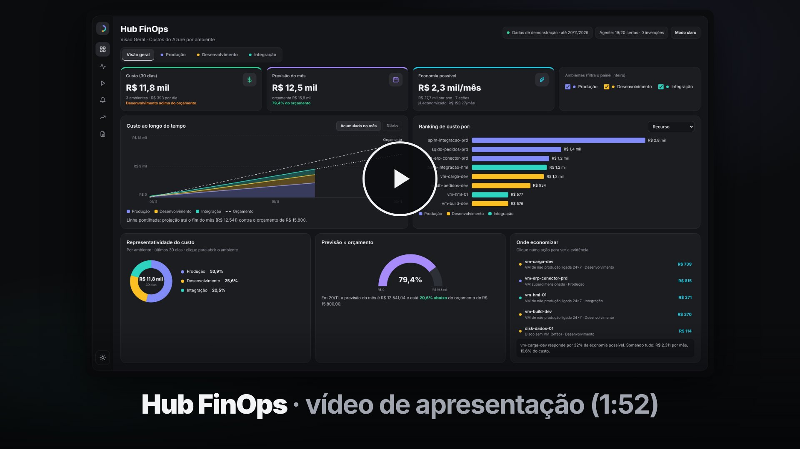

# Vídeos do Hub FinOps

| Vídeo | Para quê | Duração |
|---|---|---|
| **[Apresentação com narração](hub-finops-apresentacao.mp4)** | Vender a ideia: da dor ao produto, com voz e legendas | 1:52 |
| **[Apresentação com música](hub-finops-apresentacao-musica.mp4)** | O mesmo vídeo sem voz, só legendas e trilha de apresentação de produto (para tocar sem som alto ou em loop num evento) | 1:52 |
| **[Tour por todas as telas](hub-finops-tour.mp4)** | Mostrar o produto funcionando: cada tela do hub, com cursor, cliques e uma legenda por passo | ver abaixo |

[](hub-finops-apresentacao.mp4)

Legendas da apresentação em [`legendas.srt`](legendas.srt) (para LinkedIn, YouTube etc.).

## A apresentação

Começa pela dor (a fatura da nuvem chega e ninguém sabe quanto foi desperdício), muda o jeito de ver FinOps (não é só
cortar custo: é parar de perder dinheiro que já é seu) e só então mostra o produto.

| Cena | O que mostra |
|---|---|
| 1. Gancho | A fatura do mês e a pergunta: quanto disso foi desperdício? |
| 2. Dores | VMs de teste ligadas no fim de semana, discos sem uso, dev quase do tamanho da produção, orçamento estourado |
| 3. Virada | FinOps como margem: desperdício evitado vira lucro |
| 4–10. Produto | Telas reais do hub, com câmera e destaques no que a narração fala |
| 11. Confiança | Números calculados em código e conferidos com gabarito; IA que explica e não inventa (19/20, 0 invenções) |
| 12. Fecho | Hub FinOps · "Pare de pagar pelo que você não usa." |

## O tour

Gravado no hub de verdade (com o `docker compose` no ar), passando por: visão geral, gráfico acumulado e diário, ranking por
recurso, app e centro de custo, filtro de ambientes, representatividade, previsão × orçamento, onde economizar com a
evidência, as páginas de Produção, Desenvolvimento (causa do estouro, prestação de contas e relatório executivo) e
Integração, o modo claro, e a parte de operação: visão geral, executar com log ao vivo, histórico, resultados, chamados,
painéis do Grafana, métodos de teste e documentos.

**Tudo o que aparece é real no projeto:** as telas são do hub rodando, e os números são os dos dados de demonstração
(fictícios), os mesmos conferidos pelos testes.

## Prévia no README

`previa.gif` (21 s, sem som) junta trechos da apresentação com música: o GitHub não toca vídeo sozinho ao abrir a página,
mas toca GIF. Ela é gerada a partir do vídeo final:

```bash
# trechos (início e duração, em segundos) da apresentação com música, juntados e convertidos para GIF
ffmpeg -ss 0.3 -t 3.5 -i "apresentacao-musica.mp4" -an -vf "fps=10,scale=800:-2" trecho_0.mp4   # ... um por trecho
ffmpeg -f concat -safe 0 -i lista.txt -c copy previa.mp4
ffmpeg -i previa.mp4 -vf "fps=8,scale=720:-2,split[a][b];[a]palettegen=max_colors=128:stats_mode=diff[p];[b][p]paletteuse=dither=none:diff_mode=rectangle" -loop 0 previa.gif
```

Trechos usados: 0,3 s (3,5 s), 29,6 s (3,5 s), 47 s (4 s), 59,2 s (3,5 s), 78 s (3 s) e 106,5 s (3,5 s).

## Créditos e licenças

- Voz: [Piper](https://github.com/rhasspy/piper), voz pt-BR **faber**, licença **CC0**.
- Música (apresentação com música e tour): “Motivating Mornings”, Ahjay Stelino, do [Mixkit](https://mixkit.co/free-stock-music/tag/corporate/),
  sob a [Mixkit Stock Music Free License](https://mixkit.co/license/modal/musicFree/): uso comercial liberado em vídeos
  para web, redes sociais, anúncios online e YouTube; **não** vale para TV/rádio, CD/DVD ou jogos.
  A licença não exige crédito, mas ele aparece no fim dos dois vídeos. A faixa tem 1:36; para cobrir 1:52 ela é estendida repetindo
  8 compassos no ponto em que a música se repete, com um corte no tempo da batida (`fonte/musica.sh`).

## Como foi feito (e como refazer)

Sem editor de vídeo. Na apresentação, cada quadro é desenhado por uma página HTML (`fonte/palco.html`) e fotografado pelo
Playwright; no tour, o Playwright dirige o hub de verdade com o relógio da página controlado (`page.clock`), um quadro a
cada 1/30 s, então as animações saem suaves. O ffmpeg junta os quadros, a voz e a música.

| Passo | Arquivo | O que faz |
|---|---|---|
| 1 | `fonte/roteiro.json` | Fala (escrita para a voz, com números por extenso) e legenda (com números) de cada cena |
| 2 | `fonte/narrar.py` | Voz pt-BR **faber** do Piper, um `.wav` por cena |
| 3 | `fonte/capturar.js` | Capturas do hub em 1920×1080 com densidade 2× e a posição de cada parte da tela |
| 4 | `fonte/render.js` | Monta cada cena quadro a quadro (30 fps) a partir do `palco.html` e grava um MP4 por cena |
| 5 | `fonte/audio.py` | Narração sincronizada com as cenas, volume normalizado (-16 LUFS) e o `legendas.srt` |
| 6 | `fonte/demo.js` | O tour: roteiro de cliques e legendas, gravado quadro a quadro; termina em `fonte/fim_demo.html` |
| 7 | `fonte/musica.sh` | Baixa a trilha do Mixkit, estende até a duração do vídeo e mistura com o vídeo mudo |

```bash
# com o hub no ar (docker compose up -d --build) e Node + Playwright instalados
cd docs/video/fonte
python narrar.py                  # precisa da voz em vozes/ (ver o topo do arquivo)
node capturar.js                  # capturas em cap/
node render.js cenas              # um MP4 por cena em cenas/
python audio.py                   # narracao.wav + legendas.srt
ls cenas/*.mp4 | sed "s#cenas/#file '#; s#\$#'#" > cenas/lista.txt
ffmpeg -f concat -safe 0 -i cenas/lista.txt -c copy video_mudo.mp4
ffmpeg -i video_mudo.mp4 -i narracao.wav -map 0:v -map 1:a -c:v copy -c:a aac -shortest -movflags +faststart video.mp4
node demo.js tour_mudo.mp4        # o tour (sem som); a música entra com ffmpeg, como na apresentação
```

Os MP4 deste repositório são versões mais leves. As versões em 1080p ficam fora do Git.
